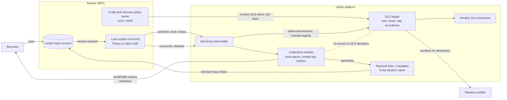
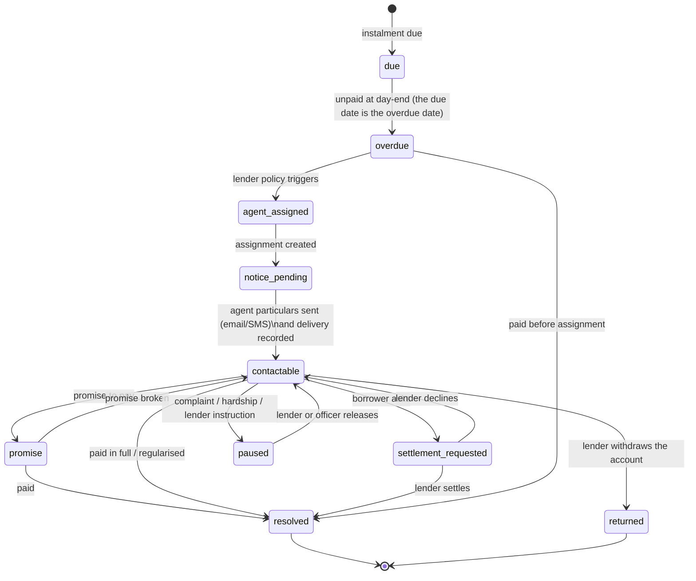
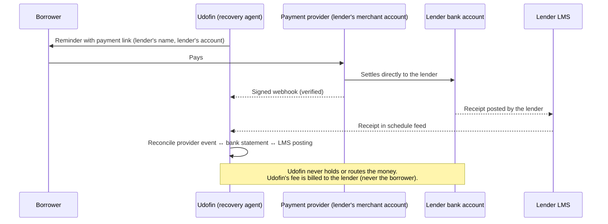

# Collections, recovery and the default loss guarantee (DLG): architecture

**Status:** design for owner approval. Implementation is **Phase 08** (servicing, payments, mandates and collections), with the data-model review in Phase 02. Nothing described here exists in code yet.
**Decision basis:** owner decisions of 13 October 2026: Udofin (Infrabyx Consultancy OPC Private Limited) provides a **5% DLG** to partner NBFCs and acts as the lenders' **recovery agent**.
**Regulatory basis:** RBI Credit Facilities Directions, 2025, Chapter III, read from the primary text (paragraph numbers below), see [`../regulatory/primary/01-credit-facilities-chapter-III-digital-lending.md`](../regulatory/primary/01-credit-facilities-chapter-III-digital-lending.md). Recovery-agent _conduct_ rules are in the Responsible Business Conduct Directions, 2025 (updated 1 Apr 2026), now read from the primary text: [`../regulatory/primary/06-responsible-business-conduct-directions-2025.md`](../regulatory/primary/06-responsible-business-conduct-directions-2025.md). Provisioning and capital effects of DLG: notes `09` and `10`. Amendments after 1 April 2026 (including the 6 August 2026 recovery amendment) are **not** in the supplied text.

## 1. Three things that must not be confused

|                     | **Servicing**                                                      | **Collections**                                                                           | **DLG**                                                                                         |
| ------------------- | ------------------------------------------------------------------ | ----------------------------------------------------------------------------------------- | ----------------------------------------------------------------------------------------------- |
| What it is          | The loan's truth: balance, schedule, receipts, status              | Work to get an overdue borrower to pay: contact, reminders, promises, settlement requests | A financial promise by Udofin to the lender, capped and ledgered                                |
| Owner of the record | **The lender's LMS** (Finbyx or other). Udofin keeps a read-model. | The lender, with Udofin as its agent. Udofin keeps the work log.                          | Contract between lender and Udofin; Udofin keeps the ledger, the lender holds the cover.        |
| Money movement      | Borrower to **lender's account** only (10(2))                      | **None by Udofin.** Payment links and mandates in the lender's name.                      | Cover is **cash with the lender, FD lien or bank guarantee** (23). Udofin never holds the cash. |
| Effect on borrower  | Their liability                                                    | Their experience; strictly regulated conduct                                              | **None. DLG invocation does not reduce what the borrower owes** (25(2)).                        |

The single most important rule in the whole design: **a DLG invocation changes the lender/Udofin relationship, never the borrower's account.** The servicing read-model and the DLG ledger share no balance columns, and a test asserts that invoking DLG leaves every borrower-facing figure unchanged.

## 2. Context

## 3. Rules the system must enforce, by paragraph

| Para         | Rule                                                                                                                                | Where it is enforced                                                                                                                                                                           |
| ------------ | ----------------------------------------------------------------------------------------------------------------------------------- | ---------------------------------------------------------------------------------------------------------------------------------------------------------------------------------------------- |
| 6(5), 9(6)   | Recovery agent particulars are sent to the borrower by email/SMS **before first contact**, and again on a change of agent           | `collection_assignments.notice_sent_at` required before any `collection_contacts` row can be created for the account (database check plus API)                                                 |
| 10(2), 10(3) | Repayment goes straight to the lender's account; no pass-through or pool account; LSP does not control the flow                     | Payment links are created only against the lender's configured collection account; Udofin has **no** collection account in the schema; settlement is reconciled against the lender's statement |
| 10(4), 10(5) | LSP fees are paid by the NBFC and never charged to the borrower, including from recovery proceeds                                   | No borrower-facing fee column exists in collections or payments; fee accrual lines debit the **lender** only (Phase 10 books)                                                                  |
| 10(5)        | Cash recovery by a physical interface is exempt but must reflect in the borrower's account the **same day**                         | `cash_receipts` is **disabled by default**; when enabled per lender it requires same-day posting evidence, and a breach alert at end of day                                                    |
| 19           | DLG provider is a company under the Companies Act 2013                                                                              | Recorded on the DLG arrangement (entity, CIN) and checked at onboarding                                                                                                                        |
| 20(3)        | Auditor-certified declaration at entry and renewal: aggregate DLG outstanding, number of lenders and portfolios, past default rates | Report generated from the ledger; certificate stored as a document with the auditor's name and date                                                                                            |
| 22           | Explicit, enforceable contract: cover extent, form, invocation timeline, disclosures                                                | Contract reference and key terms stored on the arrangement; arrangements cannot go `active` without them                                                                                       |
| 23           | Cover only as cash with the NBFC, FD with lien, or bank guarantee                                                                   | `cover_instruments.kind` is an enum of exactly these three                                                                                                                                     |
| 24(1)        | Cap = 5% of total amount disbursed out of the specified portfolio at any time                                                       | Computed, never typed in; a hard database check refuses any invocation or instrument that implies cover above the cap                                                                          |
| 24(2)        | The portfolio ("DLG set") is fixed: identifiable sanctioned loans; assets leave only by repayment or write-off                      | `dlg_set_loans` is append-only after the set is frozen; removal is recorded as repaid or written-off, never deleted                                                                            |
| 25(2)        | Invoked DLG is **not set off** against the borrower's loan                                                                          | See section 1; test on invocation                                                                                                                                                              |
| 25(3)        | Recoveries on invoked loans can be shared with the provider per contract                                                            | Recovery-share rules on the arrangement; amounts computed per recovery; lender confirms                                                                                                        |
| 25(4)        | Invoked DLG is **never reinstated**, including by recovery                                                                          | Cap arithmetic: `available = cap − Σ invoked`; recoveries create share entries, **not** headroom                                                                                               |
| 27(1)        | The lender invokes within **120 overdue days**, unless the borrower pays first                                                      | Ageing job raises alerts (configurable, default day 90 and day 110) and shows "days to invocation deadline" on the lender portal                                                               |
| 27(2)        | Agreement tenor ≥ longest loan tenor in the portfolio                                                                               | Checked when a set is frozen and whenever cover instruments are added or expire                                                                                                                |
| 28           | Monthly website disclosure of portfolios and amounts, within **seven working days** of month-end                                    | Disclosure job drafts the figures; a person approves; publication timestamp stored; overdue publication is a compliance alert                                                                  |
| 13, 14       | Consent, minimal data, India only                                                                                                   | Same controls as the rest of the platform; collections contact data is lender-scoped                                                                                                           |

## 4. Data model (planned, Phase 08; reviewed in Phase 02)

All tables are tenant-keyed (`lender_org_id`) with the same patterns as the baseline: forced RLS, composite tenant keys, append-only history, and idempotent writes. Names are proposals.

### 4.1 DLG ledger (`dlg` schema)

| Table                     | Purpose                                                                                                                                       | Notes                                                                                                                   |
| ------------------------- | --------------------------------------------------------------------------------------------------------------------------------------------- | ----------------------------------------------------------------------------------------------------------------------- |
| `dlg.arrangements`        | One per lender contract: entity, contract reference, cover percentage (≤ 5), cover forms, invocation timeline, recovery-share formula, status | `max 5.00` check; state: draft, active, suspended, ended                                                                |
| `dlg.sets`                | A frozen portfolio ("DLG set") inside an arrangement                                                                                          | Frozen once; `frozen_at` and a hash of its member list                                                                  |
| `dlg.set_loans`           | Member loans (reference to the servicing read-model) with sanctioned amount                                                                   | Append-only; exit reasons repaid / written_off only                                                                     |
| `dlg.disbursement_events` | Each disbursement from the set, which **activates cover proportionally**                                                                      | Idempotent on the lender's disbursement reference                                                                       |
| `dlg.cover_instruments`   | Cash deposit, FD lien, bank guarantee: amount, bank, reference, validity                                                                      | Validity must cover the longest tenor in the set                                                                        |
| `dlg.invocations`         | Lender's invocation, per loan: amount, overdue days at invocation, evidence                                                                   | Refused above available cover; refused after day 120 unless the lender records an exception reason (flagged for review) |
| `dlg.recovery_shares`     | Per-recovery split between lender and Udofin per contract                                                                                     | Does not alter cover                                                                                                    |
| `dlg.disclosures`         | Monthly publication: figures, approver, published_at, URL                                                                                     | Deadline tracked in working days                                                                                        |
| `dlg.declarations`        | Auditor-certified declarations at entry and renewal                                                                                           | Links the certificate document                                                                                          |

Derived view `dlg.cover_position` per set: `cap = 5% × Σ disbursed`, `invoked`, `available = cap − invoked` (never negative), `committed_cover` (instruments), `shortfall = cap − committed_cover` where cover instruments are lower than the cap. **A shortfall blocks new disbursements into the set** (alert to lender and Udofin finance); the lender decides.

### 4.2 Collections (`collections` schema)

| Table                             | Purpose                                                                                                                    | Notes                                                                                                                    |
| --------------------------------- | -------------------------------------------------------------------------------------------------------------------------- | ------------------------------------------------------------------------------------------------------------------------ |
| `collections.cases`               | One per overdue loan account being worked: bucket, status, assigned strategy                                               | State machine below                                                                                                      |
| `collections.assignments`         | Which recovery agent (Udofin, a sub-agent if the lender consents) is authorised for the case, with the agent's particulars | **`notice_sent_at`, `notice_channel`, `notice_delivery_status` required before contact** (9(6))                          |
| `collections.contacts`            | **Append-only** log of every attempt: channel, time, direction, outcome, staff member, script version                      | Calling-hours and channel rules come from lender policy (from the Responsible Business Conduct Directions once supplied) |
| `collections.promises`            | Promise to pay: date, amount, status                                                                                       | Breaks and keeps feed the case state                                                                                     |
| `collections.notices`             | Reminders, demand notices, the agent-assignment notice                                                                     | Content hash and delivery evidence                                                                                       |
| `collections.payment_links`       | Links created in the **lender's** name against the lender's collection account                                             | Amount, expiry, provider reference; idempotent                                                                           |
| `collections.settlement_requests` | Borrower or agent request for settlement or restructuring                                                                  | **Always forwarded to the lender; only the lender decides**                                                              |
| `collections.complaints_links`    | Cross-reference to grievance cases raised about a collections contact                                                      | Triggers review and pauses contact on request                                                                            |
| `collections.cash_receipts`       | Cash recovery (off by default per lender)                                                                                  | Same-day posting evidence required                                                                                       |

### 4.3 Permissions (additions to the catalogue)

| Key                  | Held by                          | Meaning                                                        |
| -------------------- | -------------------------------- | -------------------------------------------------------------- |
| `collections.work`   | Udofin collections agents        | Work assigned cases and log contacts                           |
| `collections.manage` | Udofin collections heads         | Assign agents, set strategies, review conduct                  |
| `collections.read`   | Lender staff, lender auditors    | View cases and the contact log of their own lender             |
| `collections.policy` | Lender recovery-policy owner     | Configure channels, hours and templates within platform limits |
| `dlg.read`           | Lender, Udofin finance, auditors | View DLG position and history                                  |
| `dlg.manage`         | Udofin finance only              | Record cover instruments, prepare disclosures                  |
| `dlg.invoke`         | Lender officers                  | Record an invocation (the lender invokes)                      |

**Segregation of duties:** the same login cannot hold both `collections.work` and `dlg.manage`; collections staff cannot see DLG invocation status per loan; DLG staff cannot contact borrowers. This protects against collection pressure being driven by Udofin's own loss exposure, which is the main conflict of interest in Udofin acting as both guarantor and collector.

## 5. Collection case lifecycle

**Dating rule (IRAC paras 11(2), 18):** the overdue date is the due date itself, flagged at that day-end, with no grace period for dating, days past due, SMA or NPA. A collections _grace period_ may delay the first **contact** only; it must never move any lender-reported date.

**Platform limits that lender policy can narrow but never widen (RBC paras 91–100):** recovery calls only between 08:00 and 19:00 (microfinance 09:00–18:00); no intimidation, humiliation, anonymous or persistent calls, no contact with family, referees or friends to pressure, no publishing of borrower names; the borrower receives the agent's details before recovery starts; every collector carries the notice, an authorisation letter and an ID card; police verification with re-verification due dates, a signed undertaking and training are recorded per collector. Every reminder states the applicable penal charge (RBC para 30(7)); collections never levies a fee of its own. The lender's recovery-grievance details are given to the borrower at disbursal (para 92). Whether SMS, e-mail and messaging fall under the hours rule is a counsel question; the platform applies the same window to all channels until advised otherwise.

`notice_pending → contactable` is the control that implements para 9(6). Every transition is an append-only event with actor and reason. The **lender** can pause or withdraw any case at any time.

## 6. Money flow for a repayment under collections

## 7. Controls against the conflict of interest

Udofin loses money when loans default (DLG) and is paid to collect them (agent). The text allows it, but the lender remains "fully responsible and liable for all acts and omissions of the LSP" (6(7)), so lenders will want evidence. The design provides:

1. Separate permissions and screens for collections and DLG (section 4.3).
2. A complete, append-only contact log with script version and outcome; the lender can inspect it at any time and export it.
3. **No collections incentive in the data model** for amounts recovered per agent. Whether to pay commissions is a business decision for counsel and each lender; if allowed, it will be configured per lender with a reviewed cap, never a free-form field.
4. Complaint feed-back: any complaint linked to a contact pauses further contact on request and appears on the lender's grievance dashboard.
5. Quarterly conduct report per lender: contacts per account, hours outside policy, complaints, promises kept.
6. A lender-controlled kill switch per case and per portfolio.

## 8. Open items before Phase 08 can start

| #   | Item                                                                                                                                                                                                                                  | Needed from              |
| --- | ------------------------------------------------------------------------------------------------------------------------------------------------------------------------------------------------------------------------------------- | ------------------------ |
| 1   | **Received 13 Oct 2026 (text as updated 1 Apr 2026).** Still needed: amendments after that date, including the Second Amendment of 15 Jun 2026 and the 6 Aug 2026 recovery amendment (IIBF certificate, call recording, visit notice) | Owner / compliance owner |
| 2   | **Answered** from the IRAC text (paras 36A–36C): DLG may count in expected credit loss only if integral to the loan contract; it never changes DPD or classification. See `primary/09`.                                               | —                        |
| 3   | Counsel's view on an OPC as DLG provider and recovery agent (capital, auditor, limits)                                                                                                                                                | Counsel                  |
| 4   | Whether recovery commissions based on amounts collected are permitted, and any lender-specific caps                                                                                                                                   | Counsel, each lender     |
| 5   | Cash recovery: will any lender use it, and who holds cash                                                                                                                                                                             | Each lender              |
| 6   | Cover instruments Udofin can actually put up (bank guarantee limits, FD) and the portfolio size they support                                                                                                                          | Owner / finance          |
| 7   | Who is the nodal grievance officer for Udofin (decision D-12) and the collections head                                                                                                                                                | Owner                    |
| 8   | Statutory auditor and the format of the 20(3) declaration                                                                                                                                                                             | Owner / auditor          |

## 9. Acceptance tests (to be written with Phase 08)

- Cap equals 5% of cumulative disbursed; rises with disbursement; **does not fall on repayment** (Case 1 of the RBI illustration); an invocation above available cover is refused (Case 2); **a recovery does not reinstate cover** (Case 3). The three RBI illustrations are reproduced as tests with the ₹ crore figures from the Directions.
- A DLG invocation leaves the borrower's balance, schedule and reported status unchanged.
- No collections contact can be created before the agent-notice delivery is recorded.
- No ledger or payment row can charge a fee to a borrower.
- A member loan cannot be added to or removed from a frozen set except through repayment or write-off.
- The monthly disclosure is drafted from the ledger and flagged late after the seventh working day.
- Cross-tenant tests: lender A cannot see lender B's sets, cases or contacts; collections staff cannot read DLG invocations.
