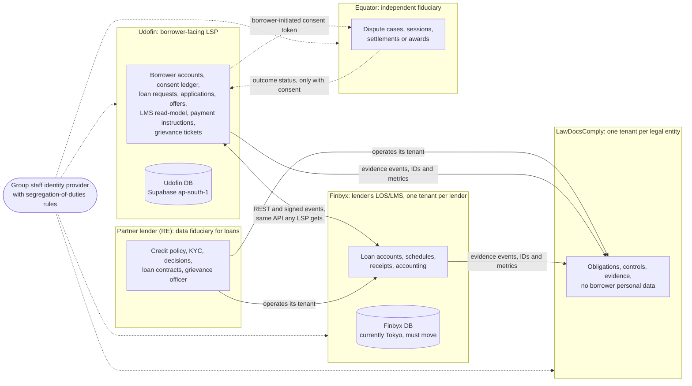
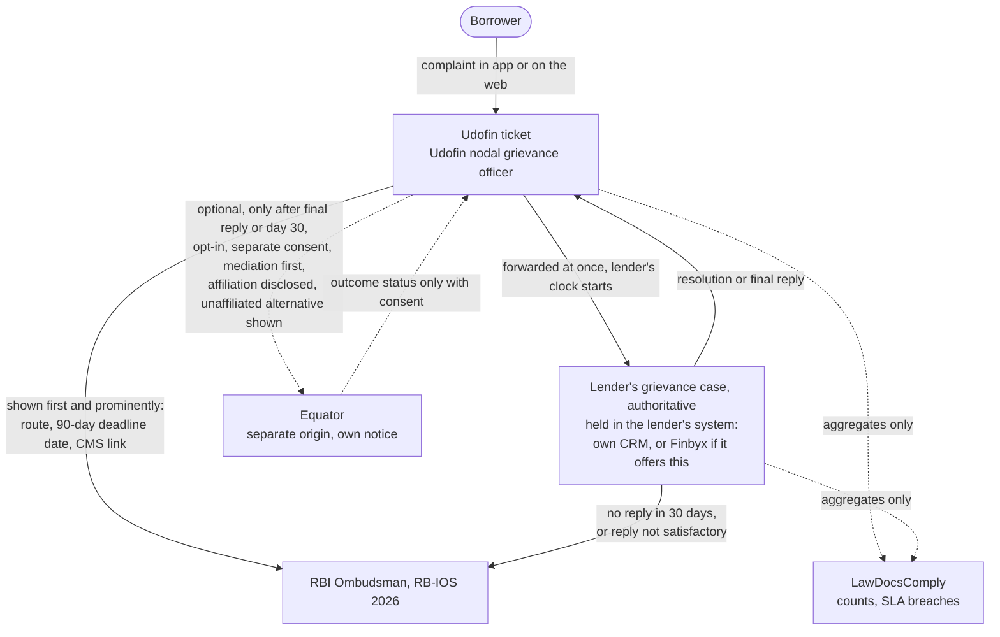

# Udofin, Finbyx, LawDocsComply and Equator: how the products relate

|                     |                                                                                                                                                                                                                     |
| ------------------- | ------------------------------------------------------------------------------------------------------------------------------------------------------------------------------------------------------------------- |
| Status              | Baseline, written in Phase 01 (Repository audit & architecture), 2026-10-10                                                                                                                                         |
| Covers              | Bounded contexts, data ownership, integration styles, deployment independence, tenancy options for lenders, the cross-product grievance path, conflict-of-interest and DPDP risks, the Finbyx Tokyo residency issue |
| Audience            | Product owner first; engineers for the integration rules                                                                                                                                                            |
| Companion documents | [`overview.md`](overview.md), [`../data/ownership.md`](../data/ownership.md)                                                                                                                                        |

> **Regulatory content: read before relying on it.** During research the sandbox could not open rbi.org.in or other primary sources (WebFetch DNS failure; the proxy blocked HTTPS), and the shared web-search budget (200 per turn) ran out. Findings rest on search snippets and secondary sources (law firms, press). Status labels from the research are kept: **confirmed**, **likely**, **interpretation**, **unverified**, **recommendation**. The public-footprint findings about the four products come only from search-engine index results; no page of any of the four sites was opened. Every regulatory paragraph reference must be verified against the primary RBI, UIDAI, MeitY or NPCI text before it is relied on in a contract, policy or launch decision. **This verification is a release gate.** Main source: `docs/research/2026-10-10/ecosystem-sites.md`.

---

## 1. The four products in one table

**Plain English.** Four separate products from one group. Each has its own database, its own releases and its own legal role. They talk to each other only through published interfaces, and they never share tables or a common customer database.

| Product                 | What it is                                                                                | Customers                                                       | Legal role towards borrower data                                                                                                                                   | Public footprint found in research                                                                                                                                                                                                                                                                                                                                                                                                                             |
| ----------------------- | ----------------------------------------------------------------------------------------- | --------------------------------------------------------------- | ------------------------------------------------------------------------------------------------------------------------------------------------------------------ | -------------------------------------------------------------------------------------------------------------------------------------------------------------------------------------------------------------------------------------------------------------------------------------------------------------------------------------------------------------------------------------------------------------------------------------------------------------- |
| **Udofin**              | Lending Service Provider (LSP) and borrower app (DLA) for several lenders                 | Borrowers; partner lenders (REs)                                | Data fiduciary for its own platform purposes (account, consents, offer comparison); processor or agent for each lender's KYC and application data [interpretation] | Only the homepage is indexed ("Udofin - Smart Loan Platform"); no lender names, grievance officer or legal entity in the index; no Google Play listing found [confirmed: search index only; live site unverified]                                                                                                                                                                                                                                              |
| **Finbyx**              | Loan origination and loan management system (LOS/LMS) offered to lenders                  | Lenders                                                         | Processor for the lender, which remains the fiduciary [recommendation in research]                                                                                 | No indexed pages [confirmed: two searches]. Claimed modules (LOS/LMS, accounting, bureau reporting, RBI returns, collections) are unverified. Its Supabase project is in Tokyo (section 9) [confirmed]                                                                                                                                                                                                                                                         |
| **LawDocsComply (LDC)** | Governance, risk and compliance (GRC) software for NBFCs and other financial institutions | Lenders, and potentially Udofin, Finbyx and Equator as entities | Holds compliance obligations, controls and evidence; should hold no borrower personal data [recommendation]                                                        | Compliance across RBI, SEBI, IRDAI, IFSCA, MCA, labour and data protection "across all group entities"; risk, litigation and contract modules; "AI-assisted legal advisory" [confirmed: snippets]                                                                                                                                                                                                                                                              |
| **Equator**             | Online dispute resolution (mediation, arbitration)                                        | Parties to a dispute                                            | Independent data fiduciary; receives data only on the borrower's explicit, post-dispute election [recommendation]                                                  | **equator.in is indexed as an unrelated facility-management company** (Equator Property Managers Pvt Ltd) [confirmed: search index; current ownership unverified]. The group's ODR platform appears to be Equa / Equa.Law (equa.law) [confirmed: snippets; group link likely]. No evidence found of recognition as a mediation service provider, designation as an arbitral institution, or SEBI ODR empanelment [confirmed only as absence in search results] |

The owner must confirm Equator's domain, brand and trademark before any borrower-facing journey, KFS or grievance notice names it (section 10).

---

## 2. Bounded contexts

What each context owns (summary; full matrix in section 3):

- **Udofin**: the borrower's account, the consents Udofin collects, the loan request, routing and offer comparison, an immutable read-model of loans it sourced, payment instructions it facilitated, and its own complaint tickets.
- **Lender (RE)**: everything about the loan as a legal and accounting matter. Finbyx, when used, holds this as the lender's processor.
- **LawDocsComply**: compliance obligations, controls and evidence per legal entity.
- **Equator**: dispute cases, only for borrowers who choose it.

---

## 3. Data ownership matrix

**Plain English.** For each kind of record: which product is the source of truth, who may read it, and on what legal footing. "Legal basis" entries carry the research status; the DPDP Act's main obligations (notice, consent, security, erasure, rights) start around 13/14 May 2027 [confirmed per `privacy-security-outsourcing.md`; a proposal to shorten this to 12 months was consulted on in January 2026, adoption unverified]. Until then the IT Act and SPDI Rules 2011 apply [likely], and RBI's digital lending data rules apply now.

| Entity                                                                         | System of record (owning product)                                                                                                   | Who may read                                                                                                     | Legal basis or consent                                                                                                                                                                  | Status in Udofin                                                                                |
| ------------------------------------------------------------------------------ | ----------------------------------------------------------------------------------------------------------------------------------- | ---------------------------------------------------------------------------------------------------------------- | --------------------------------------------------------------------------------------------------------------------------------------------------------------------------------------- | ----------------------------------------------------------------------------------------------- |
| Borrower account (sign-in identity, status, language)                          | Udofin                                                                                                                              | The borrower; Udofin staff with a need, audited                                                                  | Udofin as fiduciary for its platform [interpretation]; RBI permits an LSP to keep only basic minimal data such as name, address and contact details [confirmed (secondary)]             | Built: `identity.borrowers`; phone in Supabase Auth                                             |
| Consent records and the notice text shown                                      | Udofin (its ledger)                                                                                                                 | The borrower; each lender sees records that name it; Udofin auditors                                             | Explicit consent with an audit trail under RBI digital lending rules [confirmed (secondary)]; burden of proving consent rests on the fiduciary under DPDP s.6(10) [likely]              | Built: `consent.notices`, `consent.records`                                                     |
| Loan request (amount, tenure, purpose)                                         | Udofin                                                                                                                              | The borrower; Udofin operations staff (read-only)                                                                | Borrower's request to Udofin                                                                                                                                                            | Built: `lending.loan_requests`                                                                  |
| Lender application, decision, offer                                            | The lender (its LOS is the master once the borrower applies to it); Udofin keeps the record it routed                               | The borrower; that lender only; Udofin operations staff (read-only, audited)                                     | Prior explicit consent [confirmed (secondary)], given per named lender before any sharing [interpretation]; Udofin acts as the lender's processor for application data [interpretation] | Built: `lending.applications`, `lending.offers`                                                 |
| KYC artefacts (DigiLocker XML, CKYC record, PAN result, video KYC)             | The lender                                                                                                                          | That lender; the borrower (own data); no general Udofin staff access                                             | The lender's KYC obligation under PMLA and RBI KYC rules [likely]; consent naming the lender                                                                                            | Planned (Phase 6): lender-scoped, encrypted with that lender's key                              |
| Credit bureau report                                                           | The lender (bureau member)                                                                                                          | That lender only. Research reports that onward sharing of a credit report is restricted (CICRA s.17(4)) [likely] | Lender's membership plus borrower consent                                                                                                                                               | Planned (Phase 6): Udofin receives only the lender's outcome                                    |
| Account Aggregator data                                                        | The lender as FIU [likely]                                                                                                          | That lender                                                                                                      | AA consent artefact naming the lender                                                                                                                                                   | Planned (Phase 6)                                                                               |
| KFS, sanction letter, loan agreement, eSign and eStamp evidence                | The lender                                                                                                                          | The borrower; that lender                                                                                        | Contract between borrower and lender                                                                                                                                                    | Planned (Phase 7): Udofin keeps hashes and references                                           |
| Loan account: sanction, schedule, ledger, days past due, NPA, bureau reporting | The lender's LMS (Finbyx as processor, or third-party)                                                                              | The borrower; that lender; Udofin sees only loans it sourced, with borrower consent [recommendation]             | Loan contract; RE–LSP outsourcing agreement                                                                                                                                             | Read-model Built (`servicing.*`); sync Planned (Phase 7/8)                                      |
| Repayments and mandates                                                        | The lender (and its payment aggregator)                                                                                             | The borrower; that lender; Udofin for reconciliation                                                             | Loan contract; lender's merchant and mandate agreements                                                                                                                                 | Payment-intent schema Built; Planned (Phase 8)                                                  |
| Complaint                                                                      | Two linked records: Udofin's ticket and the lender's grievance case. **The lender's case is authoritative** for Ombudsman timelines | The borrower; that lender; Udofin's grievance officer; LawDocsComply only as aggregates (counts, SLA breaches)   | RBI digital lending grievance rules [likely]; RB-IOS 2026 [confirmed for the 30-day and 90-day rules via RBI FAQ extract]                                                               | Planned (Phase 9)                                                                               |
| Compliance obligation, control, evidence                                       | LawDocsComply, one tenant per legal entity (each lender, Udofin, Finbyx, Equator)                                                   | That entity's compliance staff; no Udofin access to lender tenants                                               | Business data; no borrower personal data [recommendation]                                                                                                                               | Planned (Phase 10): Udofin sends evidence events                                                |
| Dispute case: parties, pleadings, sessions, settlement or award                | Equator                                                                                                                             | The parties and the neutral; Udofin or the lender receive outcome status only if the borrower consents           | Borrower's separate, post-dispute, opt-in consent; mediation confidentiality [likely]                                                                                                   | Planned (Phase 9)                                                                               |
| DLG/FLDG exposure ledger                                                       | Udofin (as provider, if it provides DLG) and the lender (invocations), reconciled                                                   | Udofin finance; that lender                                                                                      | DLG contract [confirmed (secondary) for the DLG framework]                                                                                                                              | Planned (Phase 10); whether Udofin provides DLG is an open decision                             |
| Audit-trail anchors (digests, no personal data)                                | Udofin                                                                                                                              | Udofin auditors; lenders as evidence                                                                             | Udofin's own control                                                                                                                                                                    | Built: `audit.anchors`; export to write-once storage (possibly LawDocsComply) Planned (Phase 3) |
| Staff identities                                                               | Each product's own auth, optionally federated from one group identity provider                                                      | Each product's administrators                                                                                    | Employment                                                                                                                                                                              | Udofin memberships Built; SSO Planned (Phase 3 email + MFA; SAML later)                         |

**Prohibited:** a group-level shared customer view, data lake or cross-product join of borrower data. It would breach purpose limitation under DPDP and RBI's LSP data-minimisation rule [likely].

---

## 4. Integration styles

**Plain English.** Products exchange information only through documented, versioned interfaces that each side can test. Nothing reaches into another product's database.

| Link                                            | Style                                                                                                                                                                                                                                                                                                                                                                                | What may cross                                                                                                             | Authentication                                                                      | Status                                                                                                   |
| ----------------------------------------------- | ------------------------------------------------------------------------------------------------------------------------------------------------------------------------------------------------------------------------------------------------------------------------------------------------------------------------------------------------------------------------------------ | -------------------------------------------------------------------------------------------------------------------------- | ----------------------------------------------------------------------------------- | -------------------------------------------------------------------------------------------------------- |
| Udofin ↔ lender LOS/LMS (Finbyx or third-party) | Synchronous REST for application submit, decision and offer, KFS fetch, eSign status. Signed asynchronous events (webhooks or queue) for sanction, disbursement, repayment, bounce, days-past-due change, DLG invocation                                                                                                                                                             | Fields on a per-lender allow-list agreed in the lender contract                                                            | OAuth2 client credentials or mTLS; idempotency keys on every write [recommendation] | Planned (Phase 6 to 8). Finbyx must expose the **same API to any LSP**, with no Udofin-only back channel |
| Udofin and Finbyx → LawDocsComply               | Outbound evidence and metrics events, plus pull APIs                                                                                                                                                                                                                                                                                                                                 | IDs and metrics only (for example "KFS displayed", "cooling-off honoured", "grievance SLA met"); no borrower personal data | Per-tenant credentials                                                              | Planned (Phase 10)                                                                                       |
| Udofin → Equator                                | Borrower-initiated referral: a deep link carrying a one-time, purpose-bound consent token; Equator then pulls only the consented referral package (complaint summary, loan reference, documents the borrower chose). Shown in a separately branded, **separate-origin** web view with its own privacy notice and no JavaScript bridge, so the Udofin app cannot read Equator content | Only what the borrower selected                                                                                            | The one-time token                                                                  | Planned (Phase 9)                                                                                        |
| Equator → Udofin                                | Outcome status                                                                                                                                                                                                                                                                                                                                                                       | Status only, and only if the borrower consents                                                                             | Signed callback                                                                     | Planned (Phase 9)                                                                                        |
| Staff single sign-on                            | One group workforce identity provider is acceptable **with segregation-of-duties rules**: no one may hold Udofin collections or operations roles and Equator case-administration or neutral roles at the same time [recommendation]. Lender portal can use each lender's own identity provider (SAML)                                                                                | Staff identity and group membership only                                                                                   | SAML / OIDC                                                                         | Planned (Phase 3 email + MFA; SAML later)                                                                |
| Borrower identity across products               | OIDC federation with **pairwise (per-product) subject identifiers** and an explicit "link account" consent; no silent linking; no shared borrower ID [recommendation]                                                                                                                                                                                                                | Nothing until the borrower links                                                                                           | OIDC                                                                                | Planned (Phase 9, when Equator referral is built)                                                        |

Event and webhook rules (apply to every link above):

- Events use the envelope in `packages/contracts/src/events/envelope.ts` (Built): CloudEvents 1.0 with `tenantid` (the lender), `correlationid`, `causationid` and `dataclassification`. Type names follow `in.<product>.<aggregate>.<fact>.v<major>` where product is `udofin`, `finbyx`, `lawdocscomply` or `equator` (for example `in.udofin.application.submitted.v1`). `subject` must never be a PAN, Aadhaar number or phone number.
- A breaking payload change needs a new major version; the producer publishes both versions until every consumer has moved. Consumers de-duplicate on (`source`, `id`).
- Webhooks are signed (HMAC with a timestamp and a replay window) and de-duplicated: Planned (Phase 3 mechanism, Phase 6 onward per partner). The database already de-duplicates payment-provider events on (provider, event id) (Built).
- APIs are REST with OpenAPI 3.1 generated from zod schemas, versioned under `/v1`, with RFC 9457 errors (error format Built in the API skeleton; routes Planned, Phase 3). tRPC is not used for partner APIs.

---

## 5. Deployment independence

**Plain English.** Each product can be released, scaled, audited or shut down without the others. A fault or breach in one does not expose the others' data.

| Product       | Database                      | Region                                                               | Releases     | Keys                                                                |
| ------------- | ----------------------------- | -------------------------------------------------------------------- | ------------ | ------------------------------------------------------------------- |
| Udofin        | Supabase project `Udofin-app` | ap-south-1 Mumbai [confirmed]                                        | Own pipeline | Own; per-lender data keys in AWS KMS Mumbai Planned (Phase 6)       |
| Finbyx        | Supabase project `finbyx`     | **ap-northeast-1 Tokyo** [confirmed]; must move to India (section 9) | Own          | Not reviewed                                                        |
| LawDocsComply | Not reviewed                  | Not reviewed                                                         | Own          | Per-tenant, customer-controllable keys recommended [recommendation] |
| Equator       | Not reviewed                  | Not reviewed                                                         | Own          | Not reviewed                                                        |

Rules:

- Separate databases, separate cloud projects or accounts, separate KMS keys. No shared tables, no shared database credentials, no cross-product joins.
- All production data for all four products stays in India [recommendation, derived from RBI's India-storage rule, reported as confirmed (secondary) in `rbi-digital-lending.md` and likely in `infra-stack.md`].
- A cross-product data transfer records the consent ID that authorised it in an immutable audit log [recommendation].
- `Udofin-app` and `finbyx` sit in the same Supabase organisation, so organisation-level administrators can reach both. Separate organisations, or strictly separated project roles, would better match this independence rule [interpretation].
- Contract tests between products: Planned (Phase 10).

---

## 6. Tenancy options for lenders

**Plain English.** A lender can work with Udofin in several ways. In every option, each lender's data is separated from every other lender's, and Udofin never becomes the lender's loan book.

In Udofin, every regulated legal entity is one `tenancy.organizations` row of kind `lender`, with its own registration number (required before it leaves `onboarding`), products, staff, data and (Planned, Phase 6) encryption key. Every tenant-owned row carries `lender_org_id`, and composite foreign keys stop any row pointing at another lender's data (Built, tested).

| Option                                          | What the lender uses                                                                                                                      | Loan system of record                        | `servicing.source_system` | Notes                                                                                                                                                                                                                                                                                                                         | Status                                             |
| ----------------------------------------------- | ----------------------------------------------------------------------------------------------------------------------------------------- | -------------------------------------------- | ------------------------- | ----------------------------------------------------------------------------------------------------------------------------------------------------------------------------------------------------------------------------------------------------------------------------------------------------------------------------- | -------------------------------------------------- |
| A. Udofin portal only                           | Lender portal for products, decisions and offers; its own books elsewhere                                                                 | The lender's existing system, whatever it is | `manual_import`           | Loan data is imported from the lender's records. Udofin does not become the LMS. Highest reconciliation effort                                                                                                                                                                                                                | Read-model Built; import Planned (Phase 7/8)       |
| B. Udofin + Finbyx                              | Lender portal plus Finbyx as its LMS                                                                                                      | Finbyx, as the lender's processor            | `finbyx`                  | Finbyx uses the same public API as any LSP; affiliation disclosed in the lender's outsourcing due diligence; information barriers between Finbyx and Udofin staff. Blocked until Finbyx runs in India                                                                                                                         | Planned (Phase 7/8; ecosystem items Phase 10)      |
| C. Udofin + third-party LMS                     | Lender portal or the lender's own decision system, plus its LMS                                                                           | The lender's LMS                             | `lender_lms`              | Generic REST adapter behind an LMS port in `packages/adapters`                                                                                                                                                                                                                                                                | Planned (Phase 7/8)                                |
| D1. Compliance in LawDocsComply                 | The lender's LDC tenant                                                                                                                   | n/a                                          | n/a                       | Udofin sends evidence events (IDs and metrics) to the lender's tenant, with the lender's authorisation                                                                                                                                                                                                                        | Planned (Phase 10)                                 |
| D2. Compliance embedded in Finbyx               | Finbyx compliance features, if the lender uses them (Finbyx's compliance modules are unverified)                                          | n/a                                          | n/a                       | Udofin sends the same events; only the destination differs, set per lender                                                                                                                                                                                                                                                    | Planned (Phase 10)                                 |
| D3. Neither                                     | The lender's own GRC process                                                                                                              | n/a                                          | n/a                       | Evidence exports from the lender portal                                                                                                                                                                                                                                                                                       | Planned (Phase 10)                                 |
| E. Group-level compliance with tenant switching | A lender group with several legal entities (for example an NBFC and an HFC) uses LDC "across all group entities" [confirmed: LDC snippet] | Each entity's own LMS                        | per entity                | In Udofin each entity stays a separate organisation with separate data and keys. Staff who work for several entities hold one membership per entity (the schema allows this); the lender portal will offer an entity switcher. No cross-entity view of borrower data by default; a group view would need its own lawful basis | Membership model Built; switcher Planned (Phase 4) |

---

## 7. Grievance path across products

**Plain English.** A borrower can complain inside the Udofin app. Udofin passes the complaint to the lender at once, because the lender is legally responsible and its 30-day clock matters. If the lender does not resolve it, the borrower's next step is the RBI Ombudsman, and the app must say so clearly. Equator is only ever an optional extra, offered later, with warnings, and never instead of the Ombudsman.

Key rules from research:

- The borrower must complain to the lender first. If there is no reply within **30 days**, or the reply is unsatisfactory, the borrower may go to the RBI Ombudsman under **RB-IOS 2026** (in force since 1 July 2026, replacing RB-IOS 2021) [confirmed: RBI FAQ extract].
- The Ombudsman complaint must be filed **within 90 days** of the later of the end of that timeline or the lender's last communication [confirmed: RBI FAQ extract; one secondary source still says one year].
- A complaint is **not maintainable** if the same grievance is pending before, or has been settled or decided by, a court, tribunal, arbitrator or other forum [confirmed: RE-published salient features of RB-IOS 2026]. Starting an Equator arbitration would therefore end the Ombudsman route [interpretation]; an Equator mediation after the final reply uses up the 90-day window [interpretation].
- Both the lender and the LSP must name a nodal grievance redressal officer, shown on the app, the websites and the KFS [likely].
- Whether a given NBFC is covered by RB-IOS 2026 depends on its profile (customer interface; asset threshold and HFC coverage for 2026 are unverified). The app needs a per-lender coverage flag [recommendation].
- `docs/research/2026-10-10/ecosystem-sites.md` refers to RB-IOS 2021 throughout; `grievance-adr-collections.md` confirms RB-IOS 2026 replaced it. This document uses RB-IOS 2026.

Design rules for the grievance module (all Planned, Phase 9):

- Every screen offers "raise a complaint". The AI assistant must identify itself as AI, open a ticket as soon as a complaint is expressed, always offer a human, and never reject, settle, threaten or decide credit.
- Proposed rejections are held for the lender (and its Internal Ombudsman where one applies [likely]); Udofin staff and the AI never issue a rejection.
- The final-reply template always carries the Ombudsman route, the computed 90-day deadline date and the CMS link [recommendation].
- No Equator option before the lender's final reply or day 30. No arbitration initiated from the borrower flow. No pre-dispute arbitration clause in retail loan documents. Equator's affiliation disclosed; an unaffiliated alternative shown; separate consent for any data sent to Equator.
- Whether Finbyx has a grievance module is unverified (no Finbyx pages are indexed). Where the lender keeps its case is the lender's choice; Udofin links its ticket to the lender's case reference.

---

## 8. Conflict-of-interest and DPDP risks

| #   | Risk                                                                                                                      | Why it matters                                                                                                                                                                                                                                                                                | Mitigation                                                                                                                                                                                                                                                                                                                                                        | Status                                                                          |
| --- | ------------------------------------------------------------------------------------------------------------------------- | --------------------------------------------------------------------------------------------------------------------------------------------------------------------------------------------------------------------------------------------------------------------------------------------- | ----------------------------------------------------------------------------------------------------------------------------------------------------------------------------------------------------------------------------------------------------------------------------------------------------------------------------------------------------------------- | ------------------------------------------------------------------------------- |
| 1   | Udofin has an economic stake in disputes (if it gives DLG and runs collections) while a group-affiliated forum hears them | Arbitrator ineligibility for certain relationships with a party or its affiliates (Arbitration Act s.12(5) and Seventh Schedule); disclosure duty (s.12(1), Fifth Schedule); unilateral appointment by an interested party invalidated (_Perkins Eastman_, 2019; _CORE_, 8 Nov 2024) [likely] | Post-dispute opt-in only; affiliation disclosed; unaffiliated alternative offered; independent appointing authority for Udofin-linked matters; conflict-check service in Equator with a group-affiliation registry; published outcome statistics [recommendation]                                                                                                 | Udofin side Planned (Phase 9); Equator side is Equator's to build               |
| 2   | An Equator step displaces or exhausts the Ombudsman route                                                                 | Non-maintainability bar [confirmed: RE-published features]; 90-day filing window [confirmed: RBI FAQ extract]                                                                                                                                                                                 | Ombudsman route first and prominent; Equator only after final reply or day 30; warning screen with explicit acknowledgement; no arbitration from the borrower flow                                                                                                                                                                                                | Planned (Phase 9)                                                               |
| 3   | Resolution, legal-expense or award-enforcement finance tied to Equator outcomes                                           | Incentive to steer outcomes and cross-sell [interpretation]                                                                                                                                                                                                                                   | These categories stay in `feasibility_review` and cannot be approved for lending (Built: `lending.product_categories` and the product-version trigger); structural separation; no Equator data used for Udofin credit or marketing; Udofin does not solicit Equator parties; consider dropping finance for Equator-issued awards; legal opinion before any launch | Gate Built; separation rules Planned (Phase 9)                                  |
| 4   | DPDP purpose limitation: group "single customer view"                                                                     | Each product processes for different purposes; Equator data can include family, health or children's data (high sensitivity) [likely]                                                                                                                                                         | No shared borrower ID; separate fiduciary registers; per-purpose consent artefacts; separate retention and erasure; rights handled by each fiduciary; any cross-product transfer must cite a consent artefact ID                                                                                                                                                  | Udofin consent ledger Built; transfer checks Planned (Phase 9/10)               |
| 5   | LawDocsComply holds lenders' oversight records about Udofin (due diligence, audits, complaint analytics)                  | The group could see how lenders supervise Udofin [interpretation]                                                                                                                                                                                                                             | Strict tenant isolation with per-tenant customer-controllable keys; no Udofin staff access; affiliation disclosed in the lender's outsourcing due diligence; lenders should not rely only on a group tool for LSP oversight                                                                                                                                       | LDC's to build; Udofin contract terms Planned (Phase 4)                         |
| 6   | Finbyx holds loans sourced by Udofin's competitors for the same lender                                                    | Competitive and confidentiality risk [interpretation]                                                                                                                                                                                                                                         | Information barriers (Finbyx staff separate from Udofin; product-level access logs); Udofin's integration returns only loans Udofin sourced and holds consent for; the same API for every LSP                                                                                                                                                                     | Udofin side Planned (Phase 7/8)                                                 |
| 7   | One person holds conflicting roles across products via group SSO                                                          | Undermines neutrality and segregation of duties                                                                                                                                                                                                                                               | Identity-provider rules reject conflicting role combinations (for example Udofin collections plus Equator administration); quarterly access reviews [recommendation]. Inside Udofin, tenant roles can never hold platform-only permissions (Built)                                                                                                                | Planned (Phase 3 for Udofin staff auth; group IdP rules need an owner decision) |
| 8   | Equator domain and brand                                                                                                  | equator.in is indexed as another company's site; sending complaints there would be a data breach and a misrepresentation [interpretation]                                                                                                                                                     | No equator.in in any configuration until control is proven (registrar, DNS, TLS); verified-domain allow-list; trademark clearance                                                                                                                                                                                                                                 | Owner decision                                                                  |
| 9   | Equator's public copy says its AI "decides disputes"                                                                      | An award must be a reasoned decision signed by the human arbitrator [interpretation]                                                                                                                                                                                                          | Equator AI limited to triage and drafting; correct the public copy                                                                                                                                                                                                                                                                                                | Equator's to fix                                                                |
| 10  | Finbyx data outside India                                                                                                 | See section 9                                                                                                                                                                                                                                                                                 | See section 9                                                                                                                                                                                                                                                                                                                                                     | Open                                                                            |

---

## 9. The Finbyx Tokyo residency issue

**Facts [confirmed].** A Supabase Management API call (`list_projects`, 2026-10-10) returned project `finbyx` in region **ap-northeast-1 (Tokyo)**, status ACTIVE_HEALTHY, Postgres 17.6.1.155, created 2026-07-04, in the same Supabase organisation as `Udofin-app` (ap-south-1). Source: `docs/research/2026-10-10/infra-stack.md`, section 4.

**Why it matters.** RBI's digital lending rules require borrower data to be stored only on servers in India, with data processed abroad deleted there and brought back within 24 hours (reported as confirmed (secondary) in `rbi-digital-lending.md` and as likely in `infra-stack.md`; paragraph number unverified). Lenders' outsourcing rules flow data-location, audit and inspection terms down to vendors such as Finbyx [likely]. A Supabase project's region cannot be changed in place [confirmed].

**Required actions** (from research):

1. Create a new Finbyx project in ap-south-1.
2. Migrate the data.
3. Rotate keys and URLs.
4. Delete the Tokyo project (deleting a project removes its backups, per Supabase's backup documentation).
5. If real lender or borrower data was ever stored there, record it as a compliance incident with an inventory of what was held.

**Udofin gates.**

- No Udofin environment holding real data connects to the Tokyo project.
- Option B (Udofin + Finbyx) is enabled for a lender only after Finbyx production is confirmed in India.
- A residency check that fails if any production project sits outside the India allow-list would fail today on `finbyx` [recommendation, INF-01/INF-03 in research]. Planned (Phase 11 at the latest).

What the Tokyo project holds today (test data or real data) is unknown and is an open question for the owner.

---

## 10. Open questions for the owner

1. Which legal entities own Udofin, Finbyx, LawDocsComply, LawDocs and Equa/Equator (names, CINs, shareholding)? This decides affiliate status for the Arbitration Act schedules and the DPDP fiduciary boundaries.
2. Does the group control equator.in? If not, what is Equator's canonical domain and brand (equa.law or another)? Trademark clearance for "Equator".
3. Equator's independence model: appointing authority, conflict-check registry, recognition status under the Mediation Act 2023.
4. Do any target lenders already use Finbyx or LawDocsComply, and what affiliation disclosures have been made in their outsourcing due diligence?
5. What does the Finbyx Tokyo project hold, and when will it move?
6. Will Udofin provide DLG and/or act as a lender's recovery agent? Both sharpen the conflicts in section 8.
7. Will resolution finance be offered for disputes resolved on Equator? Needs a legal opinion.

---

## Related documents

- [`overview.md`](overview.md) for containers, modules, request path and the loan journey.
- [`../data/ownership.md`](../data/ownership.md) for the per-table register.
- [`../api/integration-contracts.md`](../api/integration-contracts.md) for event and API contracts shared with other products.
- Research: `docs/research/2026-10-10/ecosystem-sites.md`, `docs/research/2026-10-10/grievance-adr-collections.md`, `docs/research/2026-10-10/privacy-security-outsourcing.md`, `docs/research/2026-10-10/infra-stack.md`.
