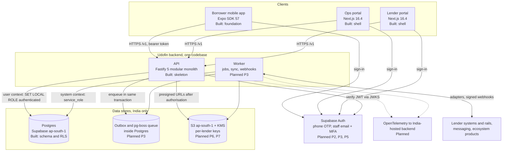
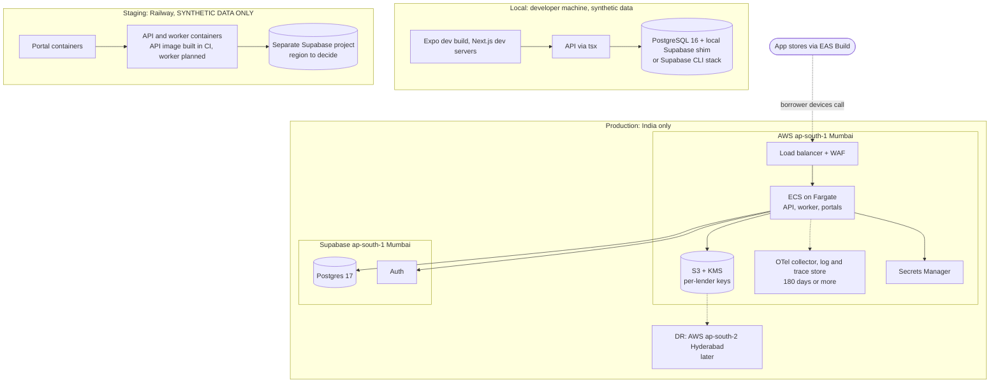
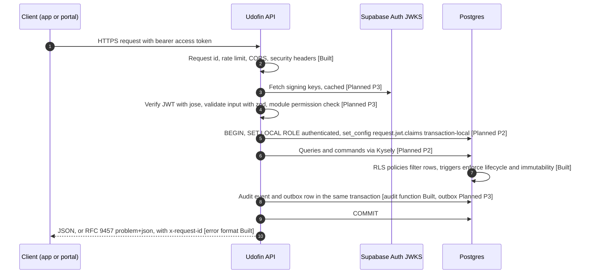
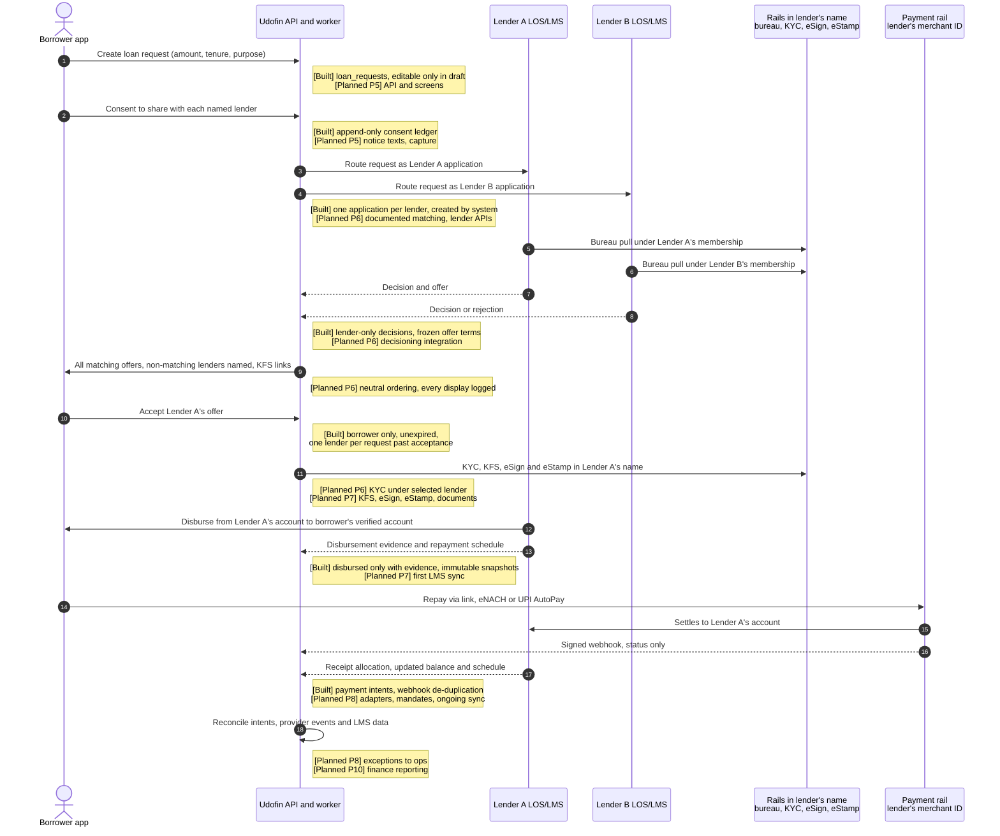

# Udofin architecture overview

|                     |                                                                                                                                                                      |
| ------------------- | -------------------------------------------------------------------------------------------------------------------------------------------------------------------- |
| Status              | Baseline, written in Phase 01 (Repository audit & architecture), 2026-10-10                                                                                          |
| Covers              | System context, containers, deployment, modules, request path, database access modes, money flow and system-of-record principles, end-to-end loan journey            |
| Audience            | Product owner (each section opens in plain English) and engineers (details and code paths follow)                                                                    |
| Companion documents | [`ecosystem.md`](ecosystem.md) (Udofin, Finbyx, LawDocsComply, Equator), [`../data/ownership.md`](../data/ownership.md) (data ownership and classification register) |

> **Regulatory content: read before relying on it.** During research the sandbox could not open rbi.org.in or other primary sources (WebFetch DNS failure; the proxy blocked HTTPS), and the shared web-search budget (200 per turn) ran out. Regulatory findings therefore rest on search snippets and secondary sources (law firms, press). This document keeps the research status labels: **confirmed**, **likely**, **interpretation**, **unverified** (plus **recommendation** where the research proposes a practice rather than reporting a rule). Every regulatory paragraph reference must be verified against the primary RBI, UIDAI, MeitY or NPCI text before anyone relies on it in a contract, policy or launch decision. **This verification is a release gate.** Nothing here states that Udofin "is compliant"; it states which control exists, what evidence it produces and what still has to be verified.

---

## 0. How to read status

- **Built**: exists in the repository and is covered by tests (pgTAP for the database: 145 assertions in `supabase/tests/`, passing locally on PostgreSQL 16 and wired into CI on the Supabase CLI with Postgres 17; Vitest for TypeScript packages and the API).
- **Planned (Phase N)**: decided, not implemented. "Decided" means it is recorded in the baseline decisions; it does not mean it has been designed in detail.

| Phase | Name                                                           |
| ----- | -------------------------------------------------------------- |
| 01    | Repository audit & architecture (this baseline)                |
| 02    | Database & security foundation                                 |
| 03    | Application foundation (auth, API platform, portals shell, CI) |
| 04    | Lender onboarding & configuration                              |
| 05    | Borrower onboarding & loan request                             |
| 06    | Verification, decisions & offers                               |
| 07    | Documents, KFS, eSign/eStamp & disbursement                    |
| 08    | Servicing, payments, mandates & collections                    |
| 09    | Grievance, AI support & Equator referral                       |
| 10    | Finance, accounting, reporting & ecosystem integrations        |
| 11    | Hardening & launch                                             |

---

## 1. Udofin in one paragraph

Udofin is a **Lending Service Provider (LSP)**. It runs a borrower app (a Digital Lending App, DLA) and two web portals so that a borrower can ask several partner lenders for a loan at once, compare their offers side by side, and complete the chosen lender's process. Three things Udofin is **not**:

1. **Not the lender.** The regulated lender (the "RE") makes the credit decision, owns KYC and bureau checks, issues the Key Facts Statement (KFS) and the loan agreement, and disburses. Udofin orchestrates screens and integrations on the lender's behalf.
2. **Not the loan system of record.** The lender's loan management system (LMS), which may be Finbyx or a third-party system, owns balances, schedules, receipt allocation, accrual, provisioning and accounting. Udofin keeps an immutable copy of what the LMS reports and reconciles against it.
3. **Not in the money flow.** Disbursements go from the lender's account to the borrower's verified account. Repayments go from the borrower to the lender's account, using the lender's own payment credentials. Udofin has no pool or pass-through account.

---

## 2. System context

**Plain English.** Who uses Udofin, and which outside systems it talks to. Everything in the "lender rails" box runs under the lender's contracts, licences and credentials; Udofin only operates the screens and the integration code.

### 2.1 Actors

| Actor                   | Uses                                   | What they do                                                                                                                                                                    | Access model                                                                                                                   | Status                                                                                                |
| ----------------------- | -------------------------------------- | ------------------------------------------------------------------------------------------------------------------------------------------------------------------------------- | ------------------------------------------------------------------------------------------------------------------------------ | ----------------------------------------------------------------------------------------------------- |
| Borrower                | Mobile app (web servicing pages later) | Signs up with phone OTP, creates a loan request, consents to share it with named lenders, compares offers, accepts one, completes the lender's KYC/KFS/eSign, repays, complains | Sees only own records (RLS on `borrower_id`)                                                                                   | Database rules Built; app flows Planned (Phase 3 auth shell, Phase 5 phone OTP and onboarding onward) |
| Lender staff            | Lender portal                          | Configure products (maker-checker), review applications, record decisions, issue and withdraw offers, view loans and payments of their own organisation                         | System roles `lender_admin`, `credit_officer`, `product_approver`, `viewer`; data limited to own `lender_org_id`               | Roles and RLS Built; portal screens Planned (Phase 3 shell, Phase 4 onward)                           |
| Udofin operations staff | Ops portal                             | Handle exceptions across lenders, read-only                                                                                                                                     | Role `operations_agent`; reads lender data only through `platform_grantable` permissions; each access to be audited by the API | Roles and RLS Built; API audit of access Planned (Phase 3)                                            |
| Platform admin          | Ops portal                             | Onboard, suspend and offboard organisations; publish consent notice versions                                                                                                    | Role `platform_admin` with platform-only permissions                                                                           | Roles Built; workflows Planned (Phase 4)                                                              |
| Auditors                | Ops portal; lender portal              | Udofin internal audit reads records and the audit trail. Lender auditors (and RBI, through the lender's contract) need read access to evidence                                  | Platform role `auditor`; lender-side auditor access Planned                                                                    | Platform role Built; lender auditor access Planned (Phase 4)                                          |
| Field agent (later)     | Assisted-onboarding app                | Captures a borrower's decisions in person                                                                                                                                       | Schema already allows `consent.channel = 'assisted'` with `captured_by`; borrower self-service inserts cannot use it           | Deferred until a lender needs assisted onboarding                                                     |
| Service-partner staff   | Lender portal                          | For example a collection agency engaged by a lender                                                                                                                             | Organisation kind `service_partner` exists                                                                                     | Planned (Phase 8)                                                                                     |

### 2.2 External systems

| External system                                                                                                                                      | Purpose                                                     | In whose name                                                                                                                                                  | Udofin's role                                                                                                           | Status                                                  |
| ---------------------------------------------------------------------------------------------------------------------------------------------------- | ----------------------------------------------------------- | -------------------------------------------------------------------------------------------------------------------------------------------------------------- | ----------------------------------------------------------------------------------------------------------------------- | ------------------------------------------------------- |
| Lender LOS/LMS: Finbyx, a third-party LMS, or manual import                                                                                          | Applications, decisions, loan accounts, schedules, receipts | Lender                                                                                                                                                         | Integrates through an adapter; keeps a read-model (`servicing.source_system` = `finbyx`, `lender_lms`, `manual_import`) | Read-model Built; adapters Planned (Phase 6 to 8)       |
| KYC: DigiLocker, CKYC registry, PAN verification, Aadhaar (through the lender's AUA/KUA or its KYC provider), bank-account verification (penny drop) | Customer due diligence                                      | Lender (per research, the RE, not the LSP, is the legal user of these rails; see `docs/research/2026-10-10/kyc-aadhaar-bureau.md` for the status of each rule) | UI and orchestration; results stored only in lender-scoped encrypted storage                                            | Planned (Phase 6)                                       |
| Credit bureaus                                                                                                                                       | Credit reports                                              | Lender's bureau membership                                                                                                                                     | No Udofin "soft pull" in its own name; receives only the lender's outcome                                               | Planned (Phase 6)                                       |
| Account Aggregators                                                                                                                                  | Consented financial data                                    | Lender as FIU [likely]                                                                                                                                         | Technology service provider                                                                                             | Planned (Phase 6)                                       |
| eSign (CCA-licensed ESP, through an aggregator) and eStamp (SHCIL / NeSL DDE through aggregators)                                                    | Execution of KFS acknowledgement and loan documents         | Lender                                                                                                                                                         | Runs the signing workflow as the lender's agent                                                                         | Planned (Phase 7)                                       |
| Payment aggregators (Razorpay, Cashfree, PayU, Juspay), eNACH and UPI AutoPay mandates, BBPS, virtual accounts                                       | Repayment collection                                        | Lender's own merchant and mandate credentials; settles to the lender's account                                                                                 | Creates payment instructions, consumes webhooks for status and reconciliation                                           | Payment-intent schema Built; adapters Planned (Phase 8) |
| Depositories and RTAs (NSDL/CDSL; CAMS, KFintech, MF Central)                                                                                        | Pledge or lien for loans against securities or mutual funds | Lender as pledgee or lien holder                                                                                                                               | Orchestration only                                                                                                      | Product category in `feasibility_review`; not scheduled |
| SMS (DLT-registered providers) and push (Expo to FCM/APNs)                                                                                           | OTP, transactional messages, reminders                      | Udofin as sender for login OTP; loan-servicing messages should name the lender (research recommendation)                                                       | Sender; no personal data in push payloads                                                                               | Planned (Phase 5 OTP, later phases for others)          |
| Accounting exports (Tally, SAP)                                                                                                                      | Udofin's own books; lender exports where asked              | Book owner                                                                                                                                                     | Export destination only, never a ledger                                                                                 | Planned (Phase 10)                                      |
| LawDocsComply                                                                                                                                        | Compliance evidence and metrics, per legal entity           | Each tenant entity                                                                                                                                             | Sends evidence events with IDs and metrics, no borrower personal data                                                   | Planned (Phase 10)                                      |
| Equator                                                                                                                                              | Optional, post-dispute, opt-in dispute resolution           | Equator as independent data fiduciary                                                                                                                          | Borrower-initiated referral with a one-time consent token                                                               | Planned (Phase 9)                                       |
| RBI Ombudsman complaint portal                                                                                                                       | Escalation route for borrowers                              | RBI                                                                                                                                                            | Link and deadline information only; no integration                                                                      | Planned (Phase 9)                                       |
| AI inference (India-hosted, for example Amazon Bedrock India geo inference per research)                                                             | Assistive support only                                      | Udofin                                                                                                                                                         | Caller; transcripts kept as records                                                                                     | Planned (Phase 9)                                       |

### 2.3 Context diagram

---

## 3. Containers

**Plain English.** The separately running pieces that make up Udofin. There is one backend codebase (a "modular monolith") that runs as two processes: the API, which answers requests, and the worker, which runs background jobs. All data stays in India.

| Container            | Technology                                                                                       | Responsibility                                                                                                                                                                                                                                          | Status                                                                                                                                                                                                                                                            |
| -------------------- | ------------------------------------------------------------------------------------------------ | ------------------------------------------------------------------------------------------------------------------------------------------------------------------------------------------------------------------------------------------------------- | ----------------------------------------------------------------------------------------------------------------------------------------------------------------------------------------------------------------------------------------------------------------- |
| Borrower mobile app  | Expo SDK 57, React Native 0.86.3, expo-router (`apps/mobile`)                                    | Borrower journeys. Declares no runtime permissions and strips 28 prohibited Android permissions through `android.blockedPermissions` in `apps/mobile/app.config.ts`. OTA updates disabled. Bundle id `com.udofin.app` is a placeholder pending decision | Built: foundation screen only. Journeys Planned (Phase 3 onward)                                                                                                                                                                                                  |
| Ops portal           | Next.js 16.4, React 19.2.3 (`apps/ops-portal`)                                                   | Udofin operations and platform administration                                                                                                                                                                                                           | Built: shell with per-request nonce CSP (`apps/ops-portal/proxy.ts`), security headers, `noindex`. Auth and screens Planned (Phase 3 onward)                                                                                                                      |
| Lender portal        | Next.js 16.4, React 19.2.3 (`apps/lender-portal`)                                                | Partner lender staff                                                                                                                                                                                                                                    | Built: shell, same controls as ops portal (`apps/lender-portal/proxy.ts`). Screens Planned (Phase 3 shell, Phase 4 onward)                                                                                                                                        |
| API                  | Fastify 5 (`services/api`)                                                                       | All reads and writes from the three clients; business rules; authorisation; integrations                                                                                                                                                                | Built: skeleton with validated config, PII-redacting logger, request ids, helmet, CORS allowlist, rate limiting, RFC 9457 errors, `/health/live` and `/health/ready`, graceful shutdown; container image `infra/docker/api.Dockerfile`. No business endpoints yet |
| Worker               | Same codebase, separate entrypoint                                                               | Outbox relay, retries, LMS sync, provider-webhook processing, routing, expiry, document generation, audit anchoring                                                                                                                                     | Planned (Phase 3)                                                                                                                                                                                                                                                 |
| Postgres             | Supabase project `Udofin-app`, ap-south-1 (Mumbai), Postgres 17.6 (confirmed in research)        | Operational store; schema source of truth is `supabase/migrations/*.sql`                                                                                                                                                                                | Built: 5 migrations with RLS, triggers and pgTAP tests                                                                                                                                                                                                            |
| Job queue and outbox | pg-boss tables and an outbox table inside the same Postgres                                      | Durable jobs enqueued in the same transaction as the business change. No Redis/BullMQ, no hosted Inngest/Trigger.dev, no Restate. Temporal (Mumbai/Hyderabad regions) only if multi-step flows become hard to manage                                    | Planned (Phase 3)                                                                                                                                                                                                                                                 |
| Object storage       | Amazon S3 ap-south-1 with SSE-KMS; per-lender data keys                                          | KYC artefacts and loan documents; served only through short-lived presigned URLs after API authorisation. Supabase Storage is not used for these, because its CDN caches signed URLs at global edges                                                    | Planned (Phase 6 and 7)                                                                                                                                                                                                                                           |
| Authentication       | Supabase Auth (same Mumbai project)                                                              | Phone OTP for borrowers; email plus MFA for staff, later SAML SSO; API verifies tokens against JWKS with `jose`                                                                                                                                         | Planned (Phase 2 staff MFA; Phase 3 token verification and portal sign-in; Phase 5 borrower phone OTP). `jose` is already a dependency of `services/api` but unused                                                                                               |
| Observability        | OpenTelemetry to an India-hosted backend (CloudWatch or self-hosted Grafana stack in ap-south-1) | Logs, traces, metrics; at least 180 days of logs in India (CERT-In [likely])                                                                                                                                                                            | Planned (Phase 3). Sentry SaaS is avoided for personal data (stores data in the US/EU [confirmed])                                                                                                                                                                |

The clients never query domain tables directly. The domain schemas (`tenancy`, `identity`, `consent`, `audit`, `lending`, `servicing`, `payments`) are not exposed through Supabase's REST layer (`supabase/config.toml` exposes only `public` and `graphql_public`), and `anon` has no rights on them (`supabase/migrations/20261010000100_foundation.sql`). Every client call goes through the API.

---

## 4. Deployment topology

**Plain English.** Three environments. Only production may ever hold real borrower or lender data, and production runs only in India. The staging environment runs on Railway, which has no India region, so it must only ever hold made-up (synthetic) data.

|                         | Local                                                                                                                                                   | Staging (and any dev/preview)                                                                                                                                                                                                                                         | Production                                                                                                                                            |
| ----------------------- | ------------------------------------------------------------------------------------------------------------------------------------------------------- | --------------------------------------------------------------------------------------------------------------------------------------------------------------------------------------------------------------------------------------------------------------------- | ----------------------------------------------------------------------------------------------------------------------------------------------------- |
| Purpose                 | Development and tests                                                                                                                                   | Integration testing, demos, lender UAT with synthetic data                                                                                                                                                                                                            | Real borrowers and lenders                                                                                                                            |
| Data                    | Synthetic only                                                                                                                                          | **Synthetic only.** Never copy production data down                                                                                                                                                                                                                   | Real data, India-only                                                                                                                                 |
| Compute                 | Developer machine: `tsx` for the API, Next.js dev servers, Expo development build                                                                       | Railway (regions: US West, US East, EU West Amsterdam, Southeast Asia Singapore; no India region, no bring-your-own-cloud [confirmed])                                                                                                                                | AWS ap-south-1 (Mumbai), ECS on Fargate (App Runner closed to new customers from 30 Apr 2026 [confirmed]) behind a regional load balancer with WAF    |
| Database and auth       | Plain PostgreSQL 16 with a local-only Supabase shim (`scripts/db/local-supabase-shim.sql`, run by `scripts/db-test-local.sh`) or the Supabase CLI stack | A separate Supabase project (region to be decided; ap-south-1 recommended so behaviour matches production)                                                                                                                                                            | Supabase project in ap-south-1 (Mumbai). Written confirmation from Supabase of where backups and platform logs live is still outstanding [unverified] |
| Files                   | Local disk or local stack                                                                                                                               | No real documents                                                                                                                                                                                                                                                     | S3 ap-south-1, SSE-KMS, Block Public Access, Object Lock for audit/log archives                                                                       |
| Logs                    | Console                                                                                                                                                 | Railway retains logs and traces (Pro plan: 30 days [confirmed]) in a location it does not document; assume outside India [unverified]. Logs must never contain personal data; the API's logger already redacts known fields                                           | OpenTelemetry collector in ap-south-1, India-hosted backend, at least 180 days in India                                                               |
| Secrets                 | `.env` files from `.env.example`                                                                                                                        | Railway sealed variables                                                                                                                                                                                                                                              | AWS Secrets Manager (ap-south-1)                                                                                                                      |
| Deployment artefact     | n/a                                                                                                                                                     | Container images built from Dockerfiles: the API image exists (`infra/docker/api.Dockerfile`, multi-stage, non-root, built in CI); portal and worker images Planned (Phase 3). No `railway.json`/`railway.toml`: Railway stops reading them on 2026-12-01 [confirmed] | Same images, deployed to ECS; infrastructure as code with OpenTofu or Terraform                                                                       |
| `APP_ENV` value in code | `local` (`test` in unit tests)                                                                                                                          | `staging`                                                                                                                                                                                                                                                             | `production`                                                                                                                                          |
| Status                  | Built (local DB tests; API, portals and app run locally)                                                                                                | Planned (Phase 3)                                                                                                                                                                                                                                                     | Planned: skeleton with no borrower data (Phase 3); in full use **before the first real borrower or lender data** (Phase 11 at the latest)             |

Additional production rules:

- Disaster recovery to AWS ap-south-2 (Hyderabad) later. Supabase offers only ap-south-1 in India [likely], so in-country database DR on Supabase is not available.
- If Supabase Edge Functions are ever used, pin them to ap-south-1; by default they run in the region nearest the caller [confirmed].
- Supabase read replicas, if added, only in ap-south-1.
- The mobile app is built with EAS Build and distributed through the stores. Push notifications pass through Expo, FCM and APNs outside India, so payloads carry no personal data.

---

## 5. Modules (bounded contexts)

**Plain English.** Inside the single backend, the code is split into modules with clear owners, like departments. Each module owns its own tables; other modules ask it, they do not reach into its tables. This keeps one deployable system (simple to run) while keeping the boundaries we would need if a module ever had to be split out.

Rules:

- One deployable API plus one worker entrypoint from the same codebase. Not microservices.
- A module writes only its own tables. Other modules use its interface or its events.
- Shared code: `packages/domain` (money in paise as `bigint`, declarative state machines, the application lifecycle in `packages/domain/src/lifecycles/application.ts`) and `packages/contracts` (event envelope, problem details, money wire format). Provider interfaces ("ports") and mocks go in `packages/adapters`, which is an empty scaffold today.
- A Postgres schema can hold more than one module's tables (for example `lending` holds products, applications and offers), but each table has exactly one owning module.
- Module-boundary lint rules: Planned (Phase 3).

| Module                   | Responsibility                                                                                                               | Owned tables (existing)                                                                                                                        | Status                                                                                                                                                                                |
| ------------------------ | ---------------------------------------------------------------------------------------------------------------------------- | ---------------------------------------------------------------------------------------------------------------------------------------------- | ------------------------------------------------------------------------------------------------------------------------------------------------------------------------------------- |
| identity                 | Borrower accounts: link to the sign-in identity, status, language. Minimal data only                                         | `identity.borrowers`. The phone number stays in Supabase Auth (`auth.users`)                                                                   | Built: table, signup trigger (creates a borrower unless `app_metadata.actor_type = 'staff'`), RLS. Planned (Phase 3) sign-in shell; (Phase 5) phone OTP, onboarding, account deletion |
| tenancy                  | Organisations (one platform org, lenders, service partners), memberships, roles, permissions                                 | `tenancy.organizations`, `tenancy.permissions`, `tenancy.roles`, `tenancy.role_permissions`, `tenancy.memberships`, `tenancy.membership_roles` | Built: guards (platform roles only for platform members; tenant roles never hold platform-only permissions), RLS helpers. Planned (Phase 4) onboarding workflow                       |
| consent                  | Versioned notices with SHA-256 of the exact wording; append-only consent ledger                                              | `consent.notices`, `consent.records`, view `consent.current_decisions`                                                                         | Built. Planned (Phase 5) notice texts, capture screens, withdrawal handling                                                                                                           |
| audit                    | Tamper-evident record of who did what                                                                                        | `audit.events`, `audit.anchors`                                                                                                                | Built: per-row hash, actor derived from the session, tamper detection even by a superuser. Planned (Phase 3) anchoring job and export to write-once storage                           |
| lender-config / products | Platform product categories; lender products and immutable, maker-checker-approved versions; later lender settings           | `lending.product_categories`, `lending.loan_products`, `lending.loan_product_versions`                                                         | Built. Planned (Phase 4) portal screens, config JSON schema, settlement accounts, grievance-officer details                                                                           |
| applications             | The borrower's loan request; one application per lender; lifecycle with actor rules and event history                        | `lending.loan_requests`, `lending.applications`, `lending.application_transitions`, `lending.application_events`                               | Built. Planned (Phase 5) request API; (Phase 6) routing                                                                                                                               |
| verification             | KYC orchestration under the lender's credentials; results only in lender-scoped encrypted storage                            | none yet                                                                                                                                       | Planned (Phase 6)                                                                                                                                                                     |
| decisioning-integration  | Sends applications to each lender's decision system or portal queue; records the lender's decision and rule version          | uses `lending.applications`, `lending.application_events`                                                                                      | Planned (Phase 6)                                                                                                                                                                     |
| offers                   | Offers with frozen terms; comparison display; acceptance; display log                                                        | `lending.offers`                                                                                                                               | Built: table and rules. Planned (Phase 6) comparison and display log                                                                                                                  |
| documents                | KFS, sanction letter and agreement from lender templates; eSign and eStamp orchestration; hashes                             | none yet (`lending.offers.kfs_document_id` is a placeholder reference)                                                                         | Planned (Phase 7)                                                                                                                                                                     |
| servicing-sync           | Read-model of the lender's LMS: loan account, disbursement evidence, schedules                                               | `servicing.loan_accounts`, `servicing.schedule_snapshots`, `servicing.schedule_installments`                                                   | Built: schema. Planned (Phase 7) first sync at disbursement; (Phase 8) ongoing sync                                                                                                   |
| payments                 | Payment instructions under the lender's credentials; provider events; reconciliation                                         | `payments.payment_intents`, `payments.provider_events`                                                                                         | Built: schema. Planned (Phase 8)                                                                                                                                                      |
| mandates                 | eNACH and UPI AutoPay mandates in the lender's name                                                                          | none yet                                                                                                                                       | Planned (Phase 8)                                                                                                                                                                     |
| collections              | Reminders; recovery-agent workflows only if the lender appoints Udofin as its recovery agent                                 | none yet                                                                                                                                       | Planned (Phase 8)                                                                                                                                                                     |
| grievance                | Complaint tickets, routing to the lender's grievance officer, 30-day clock, Ombudsman information, optional Equator referral | none yet                                                                                                                                       | Planned (Phase 9)                                                                                                                                                                     |
| notifications            | SMS (DLT), push, email; transactional and marketing kept separate                                                            | none yet                                                                                                                                       | Planned (Phase 5 for OTP SMS; later phases for others)                                                                                                                                |
| integrations             | Provider adapters (LMS, KYC, bureau, AA, eSign, payments); outbox; signed webhooks; ecosystem events; accounting exports     | `packages/adapters` (empty), `packages/contracts` (event envelope)                                                                             | Built: event envelope contract. Planned (Phase 3) outbox and worker; (Phase 6 to 8) adapters; (Phase 10) ecosystem and accounting                                                     |
| reporting                | Lender MIS, reports lenders need for their own regulatory work, Udofin's own finance views                                   | none yet                                                                                                                                       | Planned (Phase 10)                                                                                                                                                                    |

Two gaps in the module list, to resolve when Phase 10 is specified: Udofin's own double-entry books (LSP fees receivable, DLG exposure, collection fees) have no named module, and AI support (Phase 9) is a capability used by grievance and notifications, not a module that decides anything.

---

## 6. Request path

**Plain English.** When a signed-in person uses the app or a portal, the API first checks who they are and whether they may do the action. It then talks to the database **as that person**, so the database applies its own row-level rules as a second, independent check. If the API had a bug that forgot a permission check, the database would still refuse to show or change another lender's or another borrower's data.

How the database side works (Built, and exercised by the pgTAP tests, which switch users exactly this way):

- `SET LOCAL ROLE authenticated` and `set_config('request.jwt.claims', <claims>, true)` last only until the end of the transaction, so a pooled connection cannot leak one user's identity into the next request.
- RLS policies identify the caller only through `auth.uid()` (the token's `sub`). They do **not** trust role or tenant claims in the token. Permissions are looked up in `tenancy` at query time through `private.my_org_ids()`, `private.orgs_with_permission(p)` and `private.has_platform_permission(p)`. A suspended or expired membership therefore loses access immediately, without waiting for the token to expire (tested).
- These helpers return sets of organisation ids, so a policy written as `lender_org_id in (select ...)` is evaluated once per statement, not once per row.
- Column-level grants stop users rewriting tenant keys, borrower ids or amounts even where a row is visible.
- Errors never leak internals: 5xx responses carry only a generic title, a code and the request id (`services/api/src/app.ts`).

What is not built yet: the per-request transaction helper, Kysely and the API's own restricted login role (Planned, Phase 2); JWT verification and the `/v1` routes (Planned, Phase 3). Financial POSTs will require an `Idempotency-Key` header (Planned, Phase 3); the database already rejects a duplicate payment idempotency key per lender (Built).

---

## 7. Two database access modes

**Plain English.** The database is used in two ways. Most of the time the API acts **on behalf of a person**, and the database limits what that person can see and do. A few trusted background jobs act **as the system**, for example recording that a payment provider confirmed a payment. System mode is powerful, so it is kept out of the code that handles user requests.

|                                      | User context                                                                                                               | System context                                                                                                                                                                                                                                 |
| ------------------------------------ | -------------------------------------------------------------------------------------------------------------------------- | ---------------------------------------------------------------------------------------------------------------------------------------------------------------------------------------------------------------------------------------------- |
| Used by                              | The API, while serving a signed-in borrower or staff member                                                                | Worker code paths only: LMS sync, verified provider webhooks, routing a consented request to lenders, expiry jobs, audit anchoring                                                                                                             |
| Postgres role inside the transaction | `authenticated` (via `SET LOCAL ROLE`)                                                                                     | `service_role`                                                                                                                                                                                                                                 |
| `auth.uid()`                         | The caller's user id, from verified JWT claims                                                                             | `NULL`                                                                                                                                                                                                                                         |
| Row Level Security                   | Applies (forced on data tables)                                                                                            | Bypassed (`service_role` has `BYPASSRLS` in Supabase; the local shim mirrors this)                                                                                                                                                             |
| Triggers and constraints             | Always apply. The acting party is recorded as `borrower`, or as `lender` for any signed-in non-borrower                    | Always apply. The acting party is recorded as `system`                                                                                                                                                                                         |
| What only this mode can do           | Borrower: accept an offer; submit or withdraw own request. Lender staff with `application.decide`: decide and issue offers | Create applications; mark a payment intent succeeded or failed; move an application to `agreement_pending`, `agreement_executed` or `disbursed` (the last only with disbursement evidence); write the servicing read-model and provider events |
| Audit                                | `private.record_audit_event()` derives the actor from the session, so it cannot be forged (tested)                         | Writes audit events directly with actor type `system` (helper Planned, Phase 3)                                                                                                                                                                |
| Status                               | Built in the database; API side Planned (Phase 2)                                                                          | Built in the database; worker Planned (Phase 3)                                                                                                                                                                                                |

Guardrails:

- `service_role` credentials are given only to the worker process. The API's login role should be able to assume `authenticated` and nothing more. These login roles do not exist in the migrations yet: Planned (Phase 2).
- Even in system context, the database refuses to break its own rules: append-only tables cannot be edited, offer and payment amounts cannot change, an application cannot be marked disbursed without evidence, and an approved product version cannot change.
- Platform staff reach lender data only through permissions marked `platform_grantable` (`org.members.read`, `product.read`, `application.read`, `loan.read`, `payment.read`, `audit.read`). Each such access is to be audited by the API: Planned (Phase 3).

Open item: the comment in `supabase/migrations/20261010000200_tenancy_and_access.sql` says tenancy writes (onboarding organisations, managing members) happen "through the API under service_role". There is also no user-context write policy for publishing consent notices. That conflicts with the decision that `service_role` is used only in worker code paths. Resolve in Phase 2/3 by either adding narrow user-context write policies (with maker-checker) or routing these administrative commands through the worker.

---

## 8. Principles: system of record and money flow

### 8.1 System of record

**Plain English.** For every piece of information there is one place that is "the truth". For loans, that place is the lender's LMS, not Udofin.

| Information                                                                               | System of record                                                                | What Udofin keeps                                                                                                                                                   | Status                                                                    |
| ----------------------------------------------------------------------------------------- | ------------------------------------------------------------------------------- | ------------------------------------------------------------------------------------------------------------------------------------------------------------------- | ------------------------------------------------------------------------- |
| Loan balance, schedule, receipt allocation, accrual, provisioning, NPA status, accounting | Lender's LMS (Finbyx or third-party)                                            | Immutable snapshots as received (`servicing.*`), versioned; never edited, never recalculated as a competing ledger                                                  | Built (schema)                                                            |
| Credit decision                                                                           | Lender                                                                          | The outcome, offer terms and the lender's reference (`lending.applications.lender_reference`)                                                                       | Built (schema)                                                            |
| KYC results, bureau reports, AA data                                                      | Lender                                                                          | Nothing in the core schema. Where the lender instructs Udofin to hold artefacts as its processor, they go to lender-scoped storage encrypted with that lender's key | Planned (Phase 6)                                                         |
| KFS, sanction letter, loan agreement, eSign and eStamp evidence                           | Lender                                                                          | Document hashes and references; files in lender-scoped encrypted storage                                                                                            | Planned (Phase 7)                                                         |
| Borrower account                                                                          | Udofin                                                                          | Minimal data (`identity.borrowers`)                                                                                                                                 | Built                                                                     |
| Consents Udofin collects                                                                  | Udofin                                                                          | Append-only ledger                                                                                                                                                  | Built                                                                     |
| Complaint                                                                                 | Lender (authoritative) with a linked Udofin ticket                              | The Udofin ticket                                                                                                                                                   | Planned (Phase 9)                                                         |
| Udofin's own fees, DLG exposure, collection fees                                          | Udofin's double-entry books. Tally and SAP are export destinations, not ledgers | Udofin's books                                                                                                                                                      | Planned (Phase 8 DLG ledger, only if Udofin provides DLG; Phase 10 books) |

### 8.2 Money flow

**Plain English.** Money never passes through Udofin.

- No Udofin pool or pass-through account. Every payment intent names the lender's collection account it settles into (`payments.payment_intents.settlement_account_ref`); the schema has no concept of a Udofin collection account. (Built)
- Disbursement goes from the lender's account to the borrower's verified bank account. Research reports three exceptions: disbursals required by statute or regulation, money moving between lenders in co-lending, and specific end-use loans paid directly to the end-beneficiary (for example a dealer or hospital) [confirmed (secondary)]. (Planned, Phase 7)
- Repayments settle directly into the lender's account, using the lender's own merchant and mandate credentials: Razorpay, Cashfree, PayU or Juspay; eNACH or UPI AutoPay; BBPS or virtual accounts. (Planned, Phase 8)
- Stripe (invite-only in India since 2024) and PayPal (no domestic India payments since 2021) are excluded for domestic repayments. They may be used only for Udofin's own cross-border B2B billing, if ever needed.
- Udofin's own gateway account is used only for Udofin's B2B fees. The lender pays Udofin; the borrower is never charged by Udofin [confirmed (secondary)].
- Approval never moves money and never makes an application "disbursed". The database allows `disbursed` only when the lender's disbursement evidence (date, amount and bank reference, all three) is recorded (Built, tested).

---

## 9. End-to-end loan journey

**Plain English.** The full path from a borrower's request to repayment and reconciliation, across several lenders. Notes on the right show what the database already enforces and what is still to be built.

| #   | Step                                    | Acts                                          | Built today (database)                                                                                                                                                                                                                                                    | Still to build                                                                                                                                                                                                                                                                                                                                        |
| --- | --------------------------------------- | --------------------------------------------- | ------------------------------------------------------------------------------------------------------------------------------------------------------------------------------------------------------------------------------------------------------------------------- | ----------------------------------------------------------------------------------------------------------------------------------------------------------------------------------------------------------------------------------------------------------------------------------------------------------------------------------------------------- |
| 1   | Sign-up                                 | Borrower, Supabase Auth                       | Trigger creates `identity.borrowers` for every new non-staff user                                                                                                                                                                                                         | Phone OTP through a DLT-registered SMS provider, onboarding screens (Phase 5)                                                                                                                                                                                                                                                                         |
| 2   | Loan request                            | Borrower                                      | `lending.loan_requests`: borrower may edit terms only in `draft`, may only submit or withdraw; every other change is system-only                                                                                                                                          | API and screens (Phase 5)                                                                                                                                                                                                                                                                                                                             |
| 3   | Consent                                 | Borrower                                      | `consent.records` append-only; only against a published notice whose wording is hashed and immutable; lender-specific consent carries `lender_org_id`                                                                                                                     | Notice texts and capture flow (Phase 5)                                                                                                                                                                                                                                                                                                               |
| 4   | Routing to N lenders                    | System                                        | One application per lender per request (unique); composite foreign keys make cross-lender references impossible; each application pins an approved product version                                                                                                        | Documented, consistent matching method; lender API calls (Phase 6)                                                                                                                                                                                                                                                                                    |
| 5   | Lender decisions                        | Lender staff or the lender's system           | Only lender or system may move `submitted → under_review → approved/rejected`; each change logs actor and reason in `lending.application_events`; offer terms frozen once issued; one live offer per application                                                          | Decisioning integration; bureau and AA under lender credentials (Phase 6)                                                                                                                                                                                                                                                                             |
| 6   | Offer comparison                        | Borrower sees                                 | Offers carry APR, instalment, penal-charges summary and a KFS reference                                                                                                                                                                                                   | Comparison showing all matching offers with lender name, amount, tenor, APR, monthly repayment, penal charges and KFS link; non-matching lenders named; neutral, documented ordering; every display logged (Phase 6). Rule reported in research as RBI DL Directions para 6, effective 1 Nov 2025 [confirmed (secondary); paragraph number to verify] |
| 7   | Acceptance                              | Borrower                                      | Only the borrower can accept; expired offers cannot be accepted; only one lender per request can proceed past acceptance                                                                                                                                                  | Closing the other applications and marking the request `offer_selected` (Phase 6)                                                                                                                                                                                                                                                                     |
| 8   | KYC, KFS, eSign/eStamp under the lender | Borrower with the lender; Udofin orchestrates | `agreement_pending` and `agreement_executed` can be set only by the system (for example after a verified eSign callback)                                                                                                                                                  | KYC under the selected lender while the application is `offer_accepted` (Phase 6); KFS with validity window, eSign, eStamp, document storage (Phase 7)                                                                                                                                                                                                |
| 9   | Disbursement by the lender              | Lender                                        | `disbursed` only with date, amount and bank reference recorded; disbursed amount cannot exceed sanctioned amount                                                                                                                                                          | LMS callback or sync that records the evidence (Phase 7)                                                                                                                                                                                                                                                                                              |
| 10  | LMS sync                                | System                                        | Schedule snapshots and instalments are append-only and versioned                                                                                                                                                                                                          | Ongoing sync (Phase 8)                                                                                                                                                                                                                                                                                                                                |
| 11  | Repayment to the lender's account       | Borrower pays; lender receives                | Payment intents: idempotency key unique per lender; amounts and parties immutable; only the system marks `succeeded` or `failed`; borrower can cancel only a `created` intent; provider events de-duplicated on provider and event id, raw payload not stored (hash only) | Provider adapters, mandates, signature verification, cooling-off exit payments (Phase 8)                                                                                                                                                                                                                                                              |
| 12  | Reconciliation                          | System, ops                                   | —                                                                                                                                                                                                                                                                         | Matching intents, provider events and LMS receipts; exceptions to ops; the LMS stays authoritative (Phase 8); finance reporting (Phase 10)                                                                                                                                                                                                            |

---

## 10. Cross-cutting controls already in code

| Control                                                                                                                                                                                                                  | Where                                                                                          |
| ------------------------------------------------------------------------------------------------------------------------------------------------------------------------------------------------------------------------ | ---------------------------------------------------------------------------------------------- |
| Configuration validated at start-up; deployed environments require `DATABASE_URL` and `SUPABASE_URL`; no wildcard or plain-http CORS origins when deployed; no `trace` logging in production                             | `services/api/src/config.ts`                                                                   |
| Logger redacts credentials, OTPs, PAN, Aadhaar, CKYC number, phone, email, date of birth, account numbers, UPI ids, addresses and names                                                                                  | `services/api/src/logger.ts`                                                                   |
| Caller-supplied request ids accepted only if well-formed (prevents log injection); `cache-control: no-store` on every API response                                                                                       | `services/api/src/app.ts`                                                                      |
| Readiness checks with a timeout that report dependency names only, never errors                                                                                                                                          | `services/api/src/app.ts`, `services/api/src/server.ts`                                        |
| Per-request nonce Content-Security-Policy, no framing, no third-party origins; HSTS, `nosniff`, `no-referrer`, restrictive Permissions-Policy                                                                            | `apps/*/proxy.ts`, `apps/*/next.config.ts`                                                     |
| Money as integer paise (`bigint`), exact parsing, loss-free allocation; on the wire as an integer string                                                                                                                 | `packages/domain/src/money.ts`, `packages/contracts/src/primitives.ts`                         |
| Event envelope based on CloudEvents 1.0 with `tenantid`, `correlationid`, `causationid`, `dataclassification`; event types `in.<product>.<aggregate>.<fact>.v<major>` for `udofin`, `finbyx`, `lawdocscomply`, `equator` | `packages/contracts/src/events/envelope.ts`                                                    |
| Application lifecycle defined once in TypeScript and once in SQL, with a test that fails if they diverge                                                                                                                 | `packages/domain/src/lifecycles/application.ts`, `packages/domain/test/lifecycle-sync.test.ts` |
| Tenant branding limited to primary, on-primary and accent colours, with contrast checks; status colours locked                                                                                                           | `packages/design-tokens`                                                                       |

---

## 11. Open items that affect this architecture

| Item                                                                                                                                                                                                                                                                                                   | Needed by                                     |
| ------------------------------------------------------------------------------------------------------------------------------------------------------------------------------------------------------------------------------------------------------------------------------------------------------ | --------------------------------------------- |
| AWS account and owner for production in ap-south-1, in place before the first real borrower                                                                                                                                                                                                            | Before any real data (Phase 11 at the latest) |
| Supabase written confirmation of backup, PITR and platform-log residency                                                                                                                                                                                                                               | Phase 2                                       |
| API and worker login roles (API can assume only `authenticated`; worker gets `service_role`)                                                                                                                                                                                                           | Phase 2                                       |
| Write path for tenancy administration and consent-notice publishing (see section 7)                                                                                                                                                                                                                    | Phase 2/3                                     |
| CI exists (`.github/workflows/ci.yml`: format, build, lint, typecheck, unit tests, Expo config check, production dependency audit, pgTAP on the Supabase CLI with Postgres 17, gitleaks secret scan, API image build). Still missing: a check of the merged AndroidManifest for prohibited permissions | Phase 3                                       |
| Container images for the portals and the worker (only the API has one: `infra/docker/api.Dockerfile`)                                                                                                                                                                                                  | Phase 3                                       |
| Staging Supabase region                                                                                                                                                                                                                                                                                | Phase 3                                       |
| Whether Udofin provides DLG and/or acts as a lender's recovery agent (changes collections and finance scope)                                                                                                                                                                                           | Phase 8                                       |
| Primary-source legal review of every regulatory reference                                                                                                                                                                                                                                              | Release gate                                  |

---

## Related documents

- [`ecosystem.md`](ecosystem.md): how Udofin relates to Finbyx, LawDocsComply and Equator.
- [`../data/ownership.md`](../data/ownership.md): ownership, classification, retention and storage rules per table.
- [`../data/entity-model.md`](../data/entity-model.md), [`../api/README.md`](../api/README.md), [`../operations/deployment.md`](../operations/deployment.md), [`../security/threat-model.md`](../security/threat-model.md), [`../product/open-decisions.md`](../product/open-decisions.md).
- Research behind this document: `docs/research/2026-10-10/infra-stack.md`, `docs/research/2026-10-10/rbi-digital-lending.md`, `docs/research/2026-10-10/providers-payments.md`, `docs/research/2026-10-10/kyc-aadhaar-bureau.md`.
