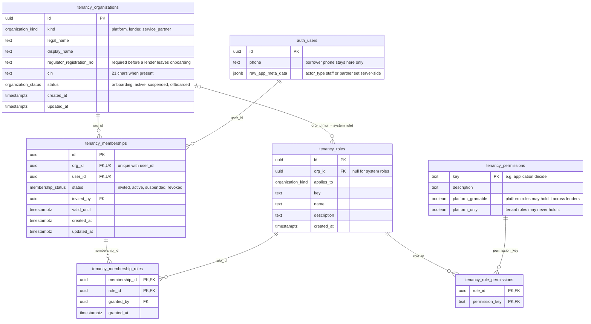
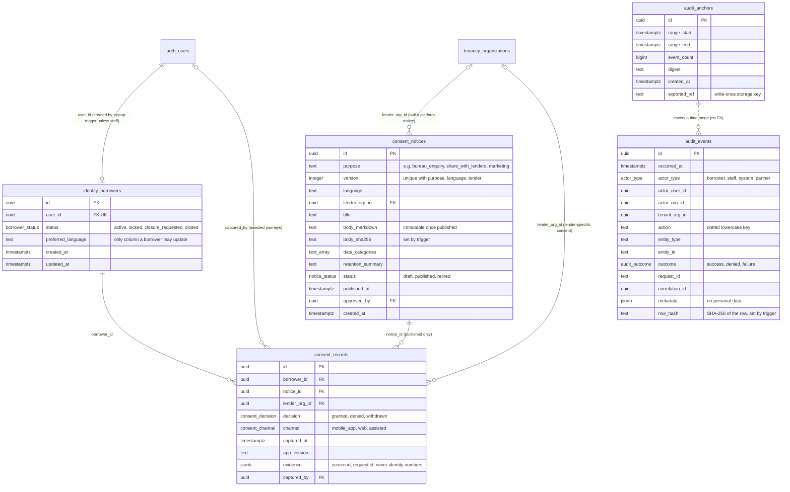
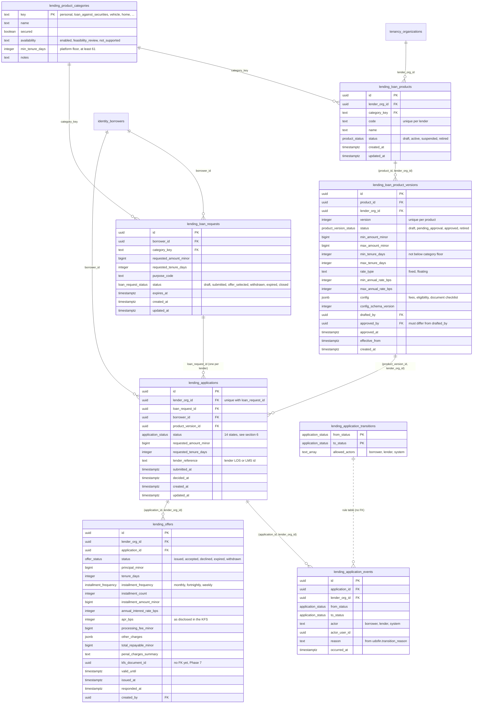
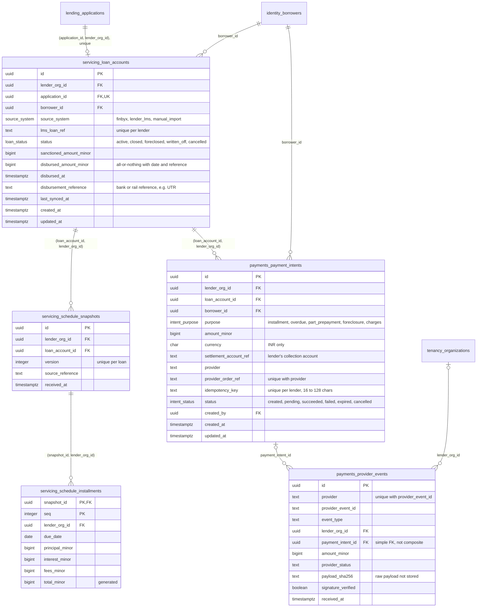

# Entity model

Status: working draft, 2026-10-10. Derived from the five migrations in `supabase/migrations/`
(`20261010000100_foundation.sql` to `20261010000500_servicing_payments.sql`) and the pgTAP tests in
`supabase/tests/`. The SQL is the source of truth; if this document and a migration disagree, the
migration wins and this document must be corrected.

> Where this document mentions regulatory reasons (LSP data minimisation, DLG, grievance timelines), they
> come from research that could not open primary sources (rbi.org.in unreachable; search budget
> exhausted). Verify against the primary texts before relying on them. This is a release gate.

---

## 1. Conventions used in every schema

| Convention                                                                                                                                                                                                            | Where it is enforced                                                                                                                                                                                                                           |
| --------------------------------------------------------------------------------------------------------------------------------------------------------------------------------------------------------------------- | ---------------------------------------------------------------------------------------------------------------------------------------------------------------------------------------------------------------------------------------------- |
| Domain schemas `tenancy`, `identity`, `consent`, `audit`, `lending`, `servicing`, `payments` are not exposed through PostgREST; clients go through the API. Helper functions live in `private`.                       | `20261010000100_foundation.sql`                                                                                                                                                                                                                |
| New tables are readable by no one until a migration grants access (default privileges revoked from `public`, `anon`, `authenticated`; `service_role` gets all). Function EXECUTE is revoked from `PUBLIC` by default. | Foundation migration                                                                                                                                                                                                                           |
| Primary keys are time-ordered UUID v7 from `private.uuid_v7()`.                                                                                                                                                       | All tables                                                                                                                                                                                                                                     |
| Tenant-owned rows carry `lender_org_id`; children reference parents with composite foreign keys `(id, lender_org_id)`, so a row cannot point at another lender's row.                                                 | `lending.*`, `servicing.*`, `payments.payment_intents`                                                                                                                                                                                         |
| Row Level Security is enabled on every domain table and **forced** on tables with borrower or tenant data.                                                                                                            | Tested in `supabase/tests/001_structure.test.sql`                                                                                                                                                                                              |
| Append-only tables reject UPDATE and DELETE with `private.forbid_mutation()`; history is corrected by compensating rows.                                                                                              | `consent.records`, `audit.events`, `audit.anchors`, `lending.application_events`, `servicing.schedule_snapshots`, `servicing.schedule_installments`, `payments.provider_events`; `lending.offers` and `payments.payment_intents` forbid DELETE |
| Money is integer paise in `bigint` columns named `*_minor`; rates are basis points in `*_bps`.                                                                                                                        | All money columns                                                                                                                                                                                                                              |
| `updated_at` maintained by `private.set_updated_at()`.                                                                                                                                                                | Mutable tables                                                                                                                                                                                                                                 |
| Security-definer helpers pin `search_path = ''` and are not executable by `anon`.                                                                                                                                     | Tested in `001_structure.test.sql`                                                                                                                                                                                                             |

Mermaid entity names below use `schema_table` (Mermaid does not accept dots). `auth_users` is Supabase
Auth's `auth.users`, which Udofin does not own. Composite foreign keys are shown on the child's columns.

---

## 2. Tenancy and access (`20261010000200_tenancy_and_access.sql`)

Rules in the schema:

- Exactly one `platform` organisation (unique partial index).
- A role can be granted only to a member of an organisation of the kind the role applies to, and a custom
  role only within its own organisation (`private.check_membership_role`).
- A tenant role can never carry a `platform_only` permission (`private.check_role_permission`).
- Reference data: 13 permissions and 7 system roles (`lender_admin`, `credit_officer`,
  `product_approver`, `viewer`; `platform_admin`, `operations_agent`, `auditor`) inserted by the migration.
- RLS helpers: `private.my_org_ids()`, `private.orgs_with_permission(p)`,
  `private.has_platform_permission(p)`. They return sets so policies evaluate once per statement. Only
  active, unexpired memberships in onboarding or active organisations count.

---

## 3. Identity, consent and audit (`20261010000300_identity_consent_audit.sql`)

Rules in the schema:

- `identity.borrowers` deliberately holds no PAN, Aadhaar, date of birth or documents; the phone number
  stays in `auth.users`. A row is created for every new auth user unless `app_metadata.actor_type` is set
  to something other than `borrower` by the server.
- Consent can be recorded only against a published notice; published notices are immutable (only
  `published → retired`), and the wording's SHA-256 is computed by trigger.
- `consent.current_decisions` (view, security invoker) gives the latest decision per (borrower, purpose,
  lender).
- Borrowers can insert their own consent records (not `assisted`); lender staff with `application.read`
  can read consents given to their lender.
- Audit rows are written through `private.record_audit_event`, which derives the actor from the session.
  `private.audit_digest(from, to)` recomputes each row's hash, so an edited row is detected even if its
  stored hash was rewritten. Users have no INSERT, UPDATE or DELETE grant on audit tables.
- Audit rows reference other tables by value (no foreign keys), so the trail survives any later change.

---

## 4. Lending (`20261010000400_lending_core.sql`)

Rules in the schema:

- **Product versions:** maker-checker (approver differs from drafter and holds `product.approve`);
  approved versions are immutable (only `approved → retired`); only categories with availability
  `enabled` can be approved (today only `personal`); tenure cannot go below the category floor.
- **Loan requests:** the borrower may only submit or withdraw, and change terms only in `draft`.
- **Applications:** one per (loan request, lender). Only one application per loan request can be in
  `offer_accepted` or any later stage. Every status change is checked against
  `lending.application_transitions` (with allowed actors) and logged in `lending.application_events` in
  the same transaction. Applications start in `draft` unless created by the system.
- **Offers:** terms immutable once issued; at most one live (`issued` or `accepted`) offer per
  application; only the borrower can accept; an expired offer cannot be accepted.
- `private.current_actor()` classifies a session as `system` (no user), `borrower` (user with a borrower
  row) or `lender` (any other authenticated user, which includes platform staff).

---

## 5. Servicing and payments (`20261010000500_servicing_payments.sql`)

Rules in the schema:

- `servicing.*` is a **read model** of the lender's LMS. Schedule snapshots and instalments are immutable
  as received; a new version supersedes the old.
- An application can move to `disbursed` only if its loan account has disbursement date and bank reference
  (`private.require_disbursement_evidence`).
- Payment intents start as `created`; must belong to the borrower's active loan; amount, parties and
  account are immutable; the provider order reference cannot change once set. Allowed transitions:
  `created → pending, failed, expired, cancelled` and `pending → succeeded, failed, expired`. Only the
  system may set any status except a borrower cancelling a `created` intent.
- Provider events are de-duplicated on (provider, provider event id) and append-only.
- LMS sync and provider-event processing run as the system (service role). Users have read access by RLS
  (borrower: own rows; lender staff: `loan.read` or `payment.read`).

---

## 6. Lifecycles

| Entity          | States                                                                                                                                                                                      | Who may change                                                                 | Defined in                                                                                  |
| --------------- | ------------------------------------------------------------------------------------------------------------------------------------------------------------------------------------------- | ------------------------------------------------------------------------------ | ------------------------------------------------------------------------------------------- |
| Application     | `draft, submitted, under_review, info_requested, approved, rejected, offer_accepted, agreement_pending, agreement_executed, disbursement_pending, disbursed, withdrawn, expired, cancelled` | Per transition: borrower, lender or system (`lending.application_transitions`) | Database table and `packages/domain/src/lifecycles/application.ts` (kept in sync by a test) |
| Loan request    | `draft, submitted, offer_selected, withdrawn, expired, closed`                                                                                                                              | Borrower: submit, withdraw; system: everything else                            | `private.protect_loan_request`                                                              |
| Product version | `draft, pending_approval, approved, retired`                                                                                                                                                | Drafter; approver with `product.approve`                                       | `private.protect_product_version`                                                           |
| Offer           | `issued, accepted, declined, expired, withdrawn`                                                                                                                                            | Borrower accepts or declines; lender withdraws                                 | `private.protect_offer` and RLS policies                                                    |
| Consent notice  | `draft, published, retired`                                                                                                                                                                 | Platform staff with `platform.consent_notices.manage` (via API)                | `private.protect_published_notice`                                                          |
| Payment intent  | `created, pending, succeeded, failed, expired, cancelled`                                                                                                                                   | System; borrower may cancel `created`                                          | `private.protect_payment_intent`                                                            |
| Membership      | `invited, active, suspended, revoked`                                                                                                                                                       | Via API under service role after permission checks                             | Tenancy migration                                                                           |

---

## 7. Gaps and inconsistencies in the current schema

These do not break the tests, but they should be fixed or consciously accepted before the related features
are built.

1. `payments.provider_events.payment_intent_id` is a simple foreign key, not composite with
   `lender_org_id`, and `lender_org_id` is nullable. A provider event could reference another lender's
   intent. Only the system writes this table, but the "cross-tenant references are impossible by
   construction" claim does not hold here.
2. `lending.applications.borrower_id` is not tied to `lending.loan_requests.borrower_id`, and
   `servicing.loan_accounts.borrower_id` is not tied to the application's borrower. Only the system
   creates these rows, but a database check (or composite key) would make mismatches impossible.
3. `lending.offers.kfs_document_id` has no foreign key yet (documents arrive in Phase 7).
4. `private.current_actor()` returns `lender` for every authenticated non-borrower, including platform
   staff and future partner service accounts, so `lending.application_events.actor` cannot tell them
   apart (the user id is recorded, so it can be resolved).
5. `private.record_audit_event` requires an authenticated user and records non-borrowers as `staff`; the
   `partner` actor type exists but nothing sets it. System jobs must insert audit rows directly under the
   service role.
6. `payments.payment_intents.idempotency_key` is unique per lender, while API idempotency is scoped per
   caller (see `docs/api/README.md` §7).
7. The foundation migration says schema ownership "is documented in `docs/data/ownership.md`" and refers
   to `supabase/config.toml`; neither file exists in the repository yet.

---

## 8. Planned entities by phase

Phase numbers follow the anchors in code comments (Phase 3: authentication through the API; Phase 4:
lender configuration and settlement accounts; Phase 5/6: KYC with per-lender keys; Phase 7: KFS documents;
Phase 7/9: DLG; Phase 9: Udofin's books). The other assignments are proposals to be aligned with the
roadmap. **Launch-critical** entities must exist before the first live borrower whatever their phase.

Every new schema must get the same treatment as the existing ones: not exposed via PostgREST, default
privileges revoked, RLS enabled and (for borrower or tenant data) forced, and added to the schema lists in
`supabase/tests/001_structure.test.sql`.

| Entity (proposed schema.table)                                                                                  | Purpose                                                                                                                                                                 | Owner module             | Tenant key                                                                     | Phase                                    | Notes                                                                                                                    |
| --------------------------------------------------------------------------------------------------------------- | ----------------------------------------------------------------------------------------------------------------------------------------------------------------------- | ------------------------ | ------------------------------------------------------------------------------ | ---------------------------------------- | ------------------------------------------------------------------------------------------------------------------------ |
| `integration.outbox_events`                                                                                     | Events written in the same transaction as the change                                                                                                                    | integrations             | `tenant_org_id` (null for platform events)                                     | 3                                        | Retained ≥ 30 days for replay; payload classified; no restricted data                                                    |
| `integration.inbox_events`                                                                                      | De-duplication of received events on (source, event id)                                                                                                                 | integrations             | `tenant_org_id`                                                                | 3                                        | Unique (source, id); payload hash, not raw body                                                                          |
| `integration.webhook_subscriptions`, `integration.webhook_deliveries`                                           | Outbound webhook targets and delivery attempts                                                                                                                          | integrations             | `org_id` of subscriber                                                         | 3                                        | Secret held as a secrets-manager reference only; deliveries append-only                                                  |
| `integration.partner_clients`                                                                                   | Partner API keys (hashed), certificate fingerprints, scopes, IP allowlist                                                                                               | tenancy / integrations   | `org_id`                                                                       | 3                                        | Maps to a service account in `auth.users`                                                                                |
| `api.idempotency_records` (non-exposed schema)                                                                  | `Idempotency-Key` store                                                                                                                                                 | API platform             | principal; `tenant_org_id` where known                                         | 3                                        | ≥ 24 h retention; encrypted response bodies                                                                              |
| `lender_config.capabilities`                                                                                    | Lender capability registry (s.11A, KUA, Setu, OVSE, DigiLocker Requester, CERSAI, OPV, bureau memberships, AA FIU, PA merchant, NACH utility) with supporting documents | lender-config            | `lender_org_id`                                                                | 4 (launch-critical)                      | Maker-checker on changes                                                                                                 |
| `lender_config.settlement_accounts`, `lender_config.provider_credentials`                                       | Lender collection accounts (`payment_intents.settlement_account_ref` target); credential references (never values)                                                      | lender-config / payments | `lender_org_id`                                                                | 4 (launch-critical)                      | Validator rejects non-lender accounts                                                                                    |
| `lending.offer_displays`                                                                                        | Log of every multi-lender offer screen shown: lenders queried, offers and non-offers, order, ranking-rule version, render hash                                          | offers                   | none at row level (spans lenders); per-lender child rows carry `lender_org_id` | 4 (launch-critical)                      | Append-only; evidence for the multi-lender display rule                                                                  |
| `verification.kyc_cases`                                                                                        | One per application per lender: method, status, lender decision and decision actor                                                                                      | verification             | `lender_org_id`                                                                | 5/6                                      | KYC "complete" writable only by the lender's user or system                                                              |
| `verification.kyc_artefacts`                                                                                    | References to lender-vault objects (S3 ap-south-1, per-lender KMS key), document types, masked display values                                                           | verification             | `lender_org_id`                                                                | 5/6                                      | Envelope encryption; no Aadhaar number, no biometrics; restricted                                                        |
| `verification.bank_account_verifications`                                                                       | Method, result, name-match band, masked account, encrypted account with keyed-hash blind index                                                                          | verification             | `lender_org_id`                                                                | 5/6                                      | Bound to the loan for disbursal and mandate                                                                              |
| `verification.bureau_enquiries`                                                                                 | Application, bureau, purpose code, enquiry ref, consent record, lender outcome ref                                                                                      | verification             | `lender_org_id`                                                                | 5/6                                      | **No report or score columns**                                                                                           |
| `verification.aa_consents`                                                                                      | AA consent handles under the lender's FIU id, status, data-life expiry                                                                                                  | verification             | `lender_org_id`                                                                | 5/6 (optional)                           | Data itself stays in lender scope                                                                                        |
| `documents.documents`                                                                                           | KFS, sanction letter, agreement, statements, NOC: kind, version, SHA-256, object key, retention class                                                                   | documents                | `lender_org_id`                                                                | 7 (launch-critical)                      | Content in S3 Mumbai; `lending.offers.kfs_document_id` gets its FK                                                       |
| `documents.signature_requests`, `documents.signature_evidence`                                                  | eSign requests and evidence (ESP transaction id, signer certificate fingerprint, audit-trail ref, validation result)                                                    | documents                | `lender_org_id`                                                                | 7 (launch-critical)                      | Evidence append-only; `provider_mode` recorded                                                                           |
| `documents.stamp_certificates`                                                                                  | eStamp certificate number, state, article, duty                                                                                                                         | documents                | `lender_org_id`                                                                | 7                                        | Duty reconciled with the lender                                                                                          |
| `payments.mandates`, `payments.mandate_presentations`                                                           | Mandate per loan (rail, provider ref, status, max amount, creditor = lender); one presentation per instalment with return code                                          | mandates                 | `lender_org_id`                                                                | 7 (launch-critical)                      | Unique (mandate, instalment ref)                                                                                         |
| `payments.reconciliation_runs`, `payments.reconciliation_items`                                                 | Daily three-way matching (intent, provider settlement, bank statement, LMS posting) and exceptions with owner and age                                                   | payments                 | `lender_org_id`                                                                | 7 (launch-critical)                      | Items resolved by compensating entries, not edits                                                                        |
| `grievance.complaints`, `grievance.complaint_events`                                                            | Udofin front-desk ticket linked to the lender's GRO case: category, channel, received time, lender due date, final reply, Ombudsman deadline; append-only timeline      | grievance                | `lender_org_id` (nullable for issues with Udofin alone)                        | 7 (launch-critical)                      | Complaint text is confidential personal data                                                                             |
| `grievance.dispute_referrals`                                                                                   | Equator referrals: consent record, token hash, redeemed time, status-sharing consent                                                                                    | grievance                | `lender_org_id`                                                                | 8 or later                               | Only after legal review (see integration contracts §6)                                                                   |
| `notifications.templates`, `notifications.messages`, `notifications.device_tokens`, `notifications.preferences` | Template registry (DLT template ids, versions, sender entity), sends and delivery status, push tokens, channel preferences                                              | notifications            | `lender_org_id` nullable (lender-branded servicing messages)                   | 7 (launch-critical for service messages) | Rendered content not stored; push payloads opaque                                                                        |
| `collections.cases`, `collections.contact_logs`                                                                 | Overdue cases from LMS DPD; every contact attempt with time, channel, agent, outcome, permitted-window flag                                                             | collections              | `lender_org_id`                                                                | 8                                        | Only if Udofin or a `service_partner` is appointed recovery agent; contact logs append-only                              |
| `dlg.arrangements`, `dlg.ledger_entries`, `dlg.portfolio_snapshots`                                             | DLG per lender per portfolio: form (cash, FD with lien, bank guarantee), cap checks, set-up, invocation and release entries                                             | dlg                      | `lender_org_id`                                                                | 7/9                                      | Only if Udofin is the DLG provider (open decision); ledger append-only                                                   |
| `accounting.accounts`, `accounting.journal_entries`, `accounting.journal_lines`, `accounting.export_batches`    | Udofin's own double-entry books (LSP fees receivable, DLG exposure, collection fees) and Tally/SAP export batches                                                       | accounting               | Legal entity = platform organisation; lines carry counterparty `lender_org_id` | 9                                        | Entries append-only and balanced; never the lender's loan books                                                          |
| `feedback.responses`                                                                                            | In-app ratings and comments with journey context                                                                                                                        | reporting                | none (optional `lender_org_id`)                                                | 8                                        | Free text may contain personal data and may express a complaint, which must open a ticket                                |
| `marketing.campaigns`, `marketing.campaign_sends`                                                               | Campaign definition with approval, frequency caps; sends with suppression reason                                                                                        | notifications            | none (Udofin's own marketing)                                                  | 8                                        | Eligibility from `consent.current_decisions` for purpose `marketing`; consent itself already lives in the consent ledger |
