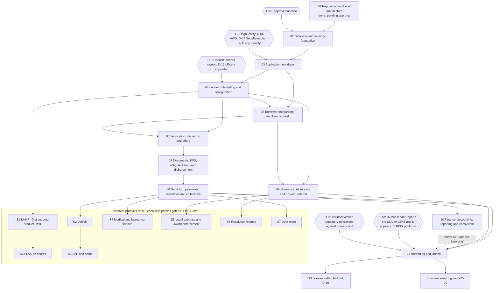

# Udofin roadmap

Date: 2026-10-10. Owner: product manager. This is the phased plan for building Udofin, a Lending
Service Provider (LSP) platform that shows borrowers loan offers from several RBI-regulated lenders.
Each phase ends with a pull request that you approve before anything is merged.

Related: [`open-decisions.md`](open-decisions.md) (decisions numbered D-01 to D-28),
[`module-status.md`](module-status.md), [`loan-products.md`](loan-products.md),
[`competitive-analysis.md`](competitive-analysis.md), [`../operations/deployment.md`](../operations/deployment.md).

> **Research limitation (applies to every regulatory statement in this document).** During
> research the sandbox could not open rbi.org.in or other primary sources (WebFetch DNS failure;
> the proxy blocked HTTPS), and the shared web-search budget ran out. Findings rest on search
> snippets and secondary sources (law firms, press). Every regulatory paragraph reference must be
> verified against the primary RBI / UIDAI / MeitY / NPCI text before it is relied on in a
> contract, policy or launch. That verification is a release gate (Phase 11, decision D-05).
> Status labels used: **confirmed / likely / interpretation / unverified**, as in the research notes.

> **Phase numbers.** This roadmap is the reference for phase numbers. Some earlier working notes
> and code comments use other numbers (for example "Phase 9" for Udofin's own books, which is
> Phase 10 here). Where they differ, this document wins.

---

## 1. What the MVP is

| Item             | MVP decision                                                                                                                                                                                                                      | Later                                                                                                      |
| ---------------- | --------------------------------------------------------------------------------------------------------------------------------------------------------------------------------------------------------------------------------- | ---------------------------------------------------------------------------------------------------------- |
| Products         | Personal loans (unsecured, tenure above 90 days; platform floor 91 days in `lending.product_categories`) from 2–4 partner lenders. Loan against mutual funds (LAMF) as the first secured product, subject to feasibility gate S1. | Other secured and specialist products in the separate track (section 5).                                   |
| Borrower channel | Android app first.                                                                                                                                                                                                                | iOS after Android (decision D-19 on the 36% APR rule). Borrower servicing web after the mobile MVP (D-20). |
| Staff channels   | Operations portal (Udofin staff) and lender portal (partner lenders).                                                                                                                                                             | Field-agent app only if a lender needs assisted onboarding (D-21).                                         |
| Udofin's role    | Lenders decide credit, own the loan record and hold all money flows. Udofin orchestrates, displays, records evidence and reconciles.                                                                                              | Unchanged.                                                                                                 |

Why this scope: Google Play admits Indian personal-loan apps only if they appear on RBI's public
list of digital lending apps (DLAs), which partner lenders populate through CIMS reporting
(confirmed via Google Help Center extract; `docs/research/2026-10-10/app-store-mobile.md` §1.2).
So nothing reaches borrowers until at least one lender has signed and reported the app. A narrow
first release with 2–4 lenders keeps that dependency manageable.

---

## 2. How we will work

Every phase, and every module inside a phase, follows the same loop. Nothing is merged without
your approval.

| Step              | What happens                                                                                                                                                                                                                | What you do                             |
| ----------------- | --------------------------------------------------------------------------------------------------------------------------------------------------------------------------------------------------------------------------- | --------------------------------------- |
| 1. Spec           | I write `docs/specs/NN-module-name.md`: objective in plain English, scope and out-of-scope, journeys, data changes, API, permissions, state changes, failure handling, regulatory controls, acceptance criteria, test plan. | Read it.                                |
| 2. Questions      | I list assumptions and only the questions that change the design (usually 3–8), each with my recommendation.                                                                                                                | Answer, or accept my recommendation.    |
| 3. Approval       | You approve the spec (in writing in the session or on the PR).                                                                                                                                                              | Say "approved" or ask for changes.      |
| 4. Implement      | I work on a feature branch named `phase-NN/<short-name>`, in small commits. Never on `main`.                                                                                                                                | Nothing.                                |
| 5. Tests          | Unit, API, pgTAP (database), negative and cross-tenant tests; `pnpm lint && pnpm typecheck && pnpm test` and the database suite. I report only tests that actually ran.                                                     | Nothing.                                |
| 6. Review         | I review my own diff for unrelated changes, secrets, security defects and honest status labels, and update module status, the controls matrix and ADRs.                                                                     | Nothing.                                |
| 7. Pull request   | PR using `.github/pull_request_template.md`, with the acceptance-criteria checklist and test evidence. CI must be green.                                                                                                    | Review the summary and the checklist.   |
| 8. Owner approval | You approve or request changes on the PR.                                                                                                                                                                                   | Approve.                                |
| 9. Merge          | Merge to `main`. Deployment to shared environments follows [`../operations/deployment.md`](../operations/deployment.md). Production deployment needs a separate explicit approval.                                          | Approve production releases separately. |

Standing rules (from `CLAUDE.md`): I challenge requests that are insecure, legally doubtful or
uneconomic before building them; I never push to `main`, deploy to production, rotate live
credentials or touch production data without your explicit authorisation; regulatory statements
keep honest status labels and are never presented as proof of compliance.

---

## 3. Dependency diagram

---

## 4. Phases

### Phase 01 — Repository audit and architecture (done, pending your approval)

**Objective.** Establish a safe foundation: a monorepo, the core database schema with tenant
isolation and audit, and research on regulation, app stores, providers and competitors, so later
phases build on tested ground rather than assumptions.

**Scope (delivered).**

- Monorepo (pnpm workspaces, Turborepo, TypeScript ~6.0.3, ESLint, Prettier).
- Database schema in `supabase/migrations/` (6 migrations) with 145 pgTAP assertions in
  `supabase/tests/` passing locally on PostgreSQL 16 (`scripts/db-test-local.sh`).
- API skeleton `services/api` (Fastify 5: validated config, PII-redacting logger, health checks,
  problem+json errors, rate limits, CORS allowlist) with 22 tests.
- App shells: `apps/mobile` (Expo SDK 57; 28 prohibited Android permissions blocked; OTA off),
  `apps/ops-portal` and `apps/lender-portal` (Next.js 16.4 with nonce-based CSP).
- Shared packages: `packages/domain` (money in paise, state machines), `packages/contracts`
  (event envelope, problem details), `packages/design-tokens`, `packages/adapters` (provider
  guard scaffold).
- Research notes in `docs/research/2026-10-10/` and the documentation set in `docs/`.

**Out of scope.** Any running environment, any real provider integration, any borrower or lender
data. Nothing has been deployed.

**Dependencies.** None.

**Deliverables.** The above, plus this roadmap, [`open-decisions.md`](open-decisions.md),
[`module-status.md`](module-status.md), [`loan-products.md`](loan-products.md),
[`competitive-analysis.md`](competitive-analysis.md) and
[`../operations/deployment.md`](../operations/deployment.md).

**Acceptance criteria.**

- `pnpm lint && pnpm typecheck && pnpm test` pass locally.
- `scripts/db-test-local.sh` applies all migrations and passes all 145 pgTAP assertions.
- The tests prove: lender A cannot read or change lender B's data; a borrower sees only their own
  records; an approved product version cannot be edited; maker and checker must differ; an
  application cannot be marked disbursed without disbursement evidence; duplicate idempotency keys
  and duplicate webhooks are rejected; append-only tables cannot be edited; the audit trail detects
  tampering.

**Security/compliance gates.** No secrets in the repository (only `*.env.example` files). Research
limitations stated in every regulatory document.

**Instruction you can give me.**

> Phase 01 is approved. I accept the architecture decisions as documented, with these changes: [none / list]. Record my approval in docs/product/module-status.md and prepare the Phase 02 spec.

---

### Phase 02 — Database and security foundation

**Objective.** Make the data layer production-grade before any feature uses it: the schema is
reviewed, it runs the same way on Supabase as locally, staff accounts need a second factor, and the
API can only reach data through the same row-level security rules the database enforces.

**Scope.**

- Review of the Phase 01 schema with written findings. Topics include: how `private.current_actor()`
  classifies platform staff (today every non-borrower user is treated as `lender`); missing tables
  that later phases need (offer-display log, per-lender settlement accounts, DLA registry);
  `lending.product_categories` availability values against the MVP (LAS is `feasibility_review`).
- Supabase CLI parity: `supabase/config.toml` and the CI job `database` in
  `.github/workflows/ci.yml` (`supabase db start && supabase test db`, Postgres 17) pass, and
  match `scripts/db-test-local.sh` (Postgres 16 with `scripts/db/local-supabase-shim.sql`).
- Auth hooks: Custom Access Token hook that adds only the claims the API needs (actor type and
  staff scope), with authorisation still decided from the database.
- Second factor for all staff (platform and lender) using Supabase Auth MFA; the API refuses staff
  requests without a completed second factor.
- API database-context layer with Kysely: every user request runs in one transaction with
  `SET LOCAL ROLE authenticated` and `set_config('request.jwt.claims', …, true)`, so RLS applies
  to the API as a second layer. A separate, restricted database role for the API. `service_role`
  only in worker code paths. Kysely types generated from the migrations.
- Authorisation matrix tests: for every system role, permission and tenant table, assert allowed
  and denied select/insert/update/delete, in pgTAP and through the API.

**Out of scope.** Business endpoints, borrower phone OTP (Phase 05), SAML SSO for lender staff
(later, when a lender asks), any hosted environment.

**Dependencies.** D-01 (baseline approved). D-07 (Supabase plan): the MFA-verification hook and
access to Supabase's SOC 2 report need the Team plan or above (confirmed, Supabase docs;
`docs/research/2026-10-10/infra-stack.md` §3).

**Deliverables.** Schema review note; corrective migrations (forward-only); hook functions;
`services/api` database module; authorisation matrix tests; Phase 02 spec in `docs/specs/`.

**Acceptance criteria.**

- The pgTAP suite passes both in CI on the Supabase stack (Postgres 17) and with
  `scripts/db-test-local.sh`.
- A structural test fails if any table in a domain schema lacks RLS enabled and forced.
- Authorisation matrix: every combination of system role × permission × tenant table has an
  explicit expected result, and all pass.
- API integration tests: a lender A token cannot read lender B's application through the API; a
  borrower token returns only that borrower's rows; a suspended membership loses access on the next
  request.
- A staff user without a completed second factor receives 401/403 from staff endpoints.
- A test or lint rule fails if `service_role` credentials are used outside worker code paths.

**Security/compliance gates.** Migration review checklist (`docs/data/migrations.md`) applied to
every new migration; no personal data added to the schema without an entry in
`docs/data/ownership.md`.

**Instruction you can give me.**

> Start Phase 02: Database and security foundation. Read docs/product/roadmap.md (Phase 02), docs/product/open-decisions.md and docs/product/module-status.md. Write docs/specs/02-database-security.md, list your questions with recommendations, and wait for my approval before writing code. Then implement on branch phase-02/db-security, add the authorisation-matrix and API RLS tests, and open a PR with the acceptance checklist completed. My decision on D-07 (Supabase plan) is: [Team / Pro].

---

### Phase 03 — Application foundation

> **Status 13 Oct 2026:** application-level scope implemented on the feature branch (sign-in for portals and app, OpenAPI, idempotency, outbox and worker, shells) and documented in [`../specs/03-application-foundation.md`](../specs/03-application-foundation.md). **Not done and still open:** infrastructure as code, deployment workflows, environments and observability (need the hosting decision and cost approval), the merged-AndroidManifest release check, and verification against a live staging Supabase project.

**Objective.** Build the plumbing every feature needs: secure login for all three front ends, a
documented API, reliable background jobs, automated build and deployment, separate environments,
and monitoring that keeps data in India.

**Scope.**

- API authentication by verifying Supabase-issued tokens against the project's JWKS endpoint with
  `jose` (asymmetric keys; no shared secret).
- OpenAPI 3.1 generated from zod schemas; versioned paths `/v1`; RFC 9457 errors;
  `Idempotency-Key` required on all financial POSTs; cursor pagination.
- Transactional outbox table and a worker entrypoint using pg-boss (jobs created in the same
  transaction as the domain change; retries, dead-letter queue, idempotent handlers).
- Portal auth shells: staff sign-in with email and second factor in `apps/ops-portal` and
  `apps/lender-portal`; session handling; role-aware navigation; no domain data yet.
- Mobile auth shell: session storage in `expo-secure-store`, API client, environment variants,
  development builds (EAS), screenshot blocking on sensitive screens. Phone OTP itself is Phase 05.
- CI/CD: extend `.github/workflows/ci.yml` with a merged-AndroidManifest permission check on the
  release build, migration lint, and container publishing; deployment workflow to dev and staging.
- Environments: local, dev, staging (synthetic data only) and a production skeleton in AWS
  ap-south-1 with no borrower data; infrastructure as code (OpenTofu or Terraform) under
  `infra/aws/`; Railway configuration, if used for non-production, in `.railway/railway.ts`
  (Railway stops reading `railway.json`/`railway.toml` on 2026-12-01; confirmed,
  `docs/research/2026-10-10/infra-stack.md` §1).
- Observability in India: OpenTelemetry to a collector and store in ap-south-1; log retention of at
  least 180 days in India; no personal data in logs, traces or alerts.

**Out of scope.** Business features; production go-live; SAML SSO; DR region.

**Dependencies.** Phase 02. Owner decisions D-02 (legal entity, for cloud and developer accounts),
D-06 (AWS account and Railway role), D-07 (Supabase plan and projects per environment), D-08 (app
name and identifiers, before the first store-linked build).

**Deliverables.** Auth middleware; OpenAPI document; outbox and worker; three auth shells; CI/CD
workflows; IaC for dev/staging/production skeleton; observability pipeline; Phase 03 spec.

**Acceptance criteria.**

- The API rejects a token not signed by the project's keys, an expired token and a token for the
  wrong audience; it accepts a valid token; a key-rotation test passes.
- The OpenAPI document is generated on every build; a test fails if a route has no request or
  response schema.
- A financial POST without `Idempotency-Key` returns 400 problem+json; repeating a request with the
  same key returns the original result and creates nothing new.
- A domain change and its outbox row commit or roll back together (test); a job that fails
  repeatedly lands in the dead-letter queue; re-running a handler causes no duplicate side effect.
- CI blocks merge on any failing job; the release build fails if the merged AndroidManifest
  contains a banned permission.
- Merge to `main` deploys to dev automatically; staging deploys the same image digest after
  approval.
- A test request containing a synthetic PAN, Aadhaar-format number and phone number produces
  no trace of them in stored logs or traces (regex scan).
- An infrastructure check fails if any production resource is outside ap-south-1 (or ap-south-2
  for DR).

**Security/compliance gates.** Secrets only in a secrets manager (none in the repository or in
`EXPO_PUBLIC_*`/`NEXT_PUBLIC_*` variables); GitHub OIDC for deployments; dependency audit and
secret scanning green; staff MFA enforced in both portals.

**Instruction you can give me.**

> Start Phase 03: Application foundation. Read docs/product/roadmap.md (Phase 03) and docs/operations/deployment.md. My decisions: D-02 legal entity [name], D-06 AWS account [owner / account to be created by me], D-07 Supabase [plan, projects per environment], D-08 app name and identifiers [values]. Write docs/specs/03-application-foundation.md with questions, wait for approval, then implement on branch phase-03/app-foundation with tests, and open a PR. Do not create any paid cloud resource without asking me first.

---

### Phase 04 — Lender onboarding and configuration

> **Spec drafted 13 Oct 2026:** [`../specs/04-lender-onboarding-configuration.md`](../specs/04-lender-onboarding-configuration.md) — awaiting owner approval. It widens this section to multiple lender types (NBFC now, banks gated), Ind AS handling and the lender transactions panel.

**Objective.** Let Udofin onboard each partner lender with everything needed to show its offers
lawfully: who the lender is, how it is regulated, whom borrowers complain to, what it lends, on what
terms, with what consent wording, and through which provider accounts held in its own name.

**Scope.**

- Lender profile: legal name, lender type (NBFC, bank, etc.), RBI registration number (already
  required by `tenancy.organizations` to leave onboarding), the instrument set that applies to that
  lender type (the 28 Nov 2025 "Credit Facilities" Directions per lender type — likely; secondary
  sources, `docs/research/2026-10-10/rbi-digital-lending.md` §2.2), RB-IOS coverage flag, Internal
  Ombudsman applicability.
- Grievance contacts per lender: grievance redressal officer, principal nodal officer, complaint
  address and links, displayed in the app and KFS.
- DLA registry per lender: whether and when the lender reported the Udofin app (package name, web
  URLs) on CIMS, evidence of the public listing, and the lender's own website listing Udofin.
- Product versions and maker-checker UI in the lender portal on top of the existing
  `lending.loan_products` / `lending.loan_product_versions` (drafter and approver must differ;
  approved versions immutable).
- Eligibility rules owned and approved by each lender, stored as versioned configuration; Udofin
  does not decide credit.
- Disclosures and consent wording per lender (versioned, hashed notices in `consent.notices`).
- Provider credentials per lender (payment gateway, mandate, KYC, bureau, AA, eSign) stored in the
  secrets manager and referenced by ID; settlement account per lender for repayments.
- Branding within `packages/design-tokens` limits (primary/onPrimary/accent, contrast enforced).
- Read-only lender auditor access to consent logs, complaint logs and DLA change history.

**Out of scope.** Borrower journeys; live calls to provider APIs (adapters are stubs with
sandbox flags); lender self-service onboarding without Udofin review.

**Dependencies.** Phase 03. D-03 (signed lender contracts, including outsourcing clauses and each
lender's commitment to report the DLA on CIMS), D-05 (counsel for contract references), D-10 (DLG
terms), D-11 (recovery-agent role, which must be named in the KFS), D-12 (Udofin's own grievance
officer), D-23 (payday confirmed out), D-09 (LAMF product structure, if LAMF is configured).

**Deliverables.** Lender onboarding module (API + ops portal), product configuration UI (lender
portal), DLA registry, per-lender consent notices, provider-credential references, Phase 04 spec.

**Acceptance criteria.**

- A lender's offers stay suppressed unless its profile is complete: registration number, lender
  type, grievance and nodal officer contacts, settlement account reference, at least one approved
  product version, and a verified DLA listing (test per missing item).
- A product version cannot be approved by its drafter or by a user without `product.approve`
  (already enforced in the database; UI and API tests added).
- A product version below the category tenure floor, or in a category that is not `enabled`,
  cannot be approved (existing trigger; API test).
- Published consent wording cannot be changed; a change creates a new version with a new hash.
- No provider secret appears in the database, logs or API responses (test and scan); every read of
  a secret reference is audited.
- A tenant colour that fails the contrast rule is rejected.
- A lender auditor account can read but not change consent logs, complaint logs and DLA history.

**Security/compliance gates.** Lender contract signed before a lender's production profile is
activated; regulatory references in disclosures checked by counsel (D-05); maker-checker on every
lender-facing configuration that affects borrowers.

**Instruction you can give me.**

> Start Phase 04: Lender onboarding and configuration. Read docs/product/roadmap.md (Phase 04), docs/product/open-decisions.md and docs/product/loan-products.md. Launch lenders are [names, lender types]; Udofin's grievance officer is [name/contact or "to be appointed"]. Write docs/specs/04-lender-onboarding.md with questions, wait for approval, implement on branch phase-04/lender-onboarding with tests, and open a PR.

---

### Phase 05 — Borrower onboarding and loan request

**Objective.** Let a borrower start in 3–4 interactions (mobile number, auto-filled OTP, consents,
basic need) and come back later to exactly where they stopped, without Udofin collecting more data
than it needs.

**Scope.**

- Phone OTP through Supabase Auth with the Send SMS hook calling a TRAI-DLT-registered SMS
  provider; OTP template carries the Android app hash for the SMS Retriever API; iOS one-time-code
  autofill; Android Phone Number Hint instead of phone permissions. The hook has a 5-second budget
  (confirmed, Supabase docs; `docs/research/2026-10-10/providers-payments.md` §12).
- Consents: unbundled, none pre-ticked; terms, privacy notice, and sharing with named lenders
  recorded in `consent.records`; marketing consent separate and optional.
- Minimal profile (name and contact only at this stage; no PAN, Aadhaar, date of birth or
  documents in Udofin's core database).
- Loan request: category, amount, tenure, purpose (`lending.loan_requests`).
- Resumable journey across app restarts and devices.
- Trust page reachable from every screen: Udofin's legal role as LSP, partner lenders, Udofin's
  and lenders' grievance officers.
- In-app account deletion (with legally required retention explained).
- Device integrity checks (Play Integrity) per D-24.

**Out of scope.** KYC, bureau checks and offers (Phase 06); marketing notifications.

**Dependencies.** Phases 03 and 04. D-02 (legal entity as DLT principal entity), D-08 (app
identity, needed for the OTP template and integrity checks), D-14 (marketing consent strategy),
D-15 (languages), D-24 (integrity threshold). External: DLT registration of sender header and
templates.

**Deliverables.** Mobile onboarding screens, consent screens, loan request flow, SMS hook, trust
page, account deletion, Phase 05 spec.

**Acceptance criteria.**

- Automated UI test: from first launch to a submitted loan request takes no more than 4
  deliberate interactions when OTP autofill works (excluding typing the amount).
- The merged AndroidManifest has no SMS, contacts, phone, storage or media permission; the OTP
  autofills on a test device.
- If the SMS provider is slower than the hook budget, the fallback path delivers an OTP and the
  user can retry.
- Declining marketing consent does not block any step; no consent box is pre-ticked (test).
- Killing and reopening the app resumes at the last completed step.
- The trust page is reachable in at most 2 taps from every screen.
- A database scan finds no PAN, Aadhaar-format number or date of birth in Udofin's core schemas.

**Security/compliance gates.** Privacy policy published naming third parties; DLT templates
registered; no prohibited permission; consent wording versioned and approved.

**Instruction you can give me.**

> Start Phase 05: Borrower onboarding and loan request. Read docs/product/roadmap.md (Phase 05) and docs/product/competitive-analysis.md. My decisions: D-14 marketing consent [approach], D-15 languages [list], D-24 integrity policy [approach]. Write docs/specs/05-borrower-onboarding.md with questions, wait for approval, implement on branch phase-05/borrower-onboarding with tests, and open a PR.

---

### Phase 06 — Verification, decisions and offers

**Objective.** With the borrower's consent, send the request to matching lenders, let each lender
run its own checks and decide, and show every resulting offer side by side in a neutral way that
meets the multi-lender display rule.

**Scope.**

- KYC through each lender's rails: DigiLocker, CKYC download or Aadhaar under the lender's
  KUA/sub-KUA, e-KYC Setu or OVSE registration; V-CIP is the lender's process. Udofin hosts the
  screens only (`docs/research/2026-10-10/kyc-aadhaar-bureau.md`).
- Bureau checks under each lender's credit-bureau membership; no Udofin-name "soft pull".
- Account Aggregator consent under each lender's FIU identity.
- Lender routing per consent: an application (`lending.applications`) is created only for lenders
  the borrower consented to.
- Decision intake from each lender's LOS or Finbyx: signed, idempotent callbacks or polling;
  outcomes recorded with the lender's rule version.
- Multi-lender comparison screen: every matching offer with lender name, amount, tenor, APR,
  monthly repayment, penal charges and a KFS link; lenders that did not offer are named; default
  order documented and not driven by Udofin's fees; no "recommended" badges or countdown timers;
  every display logged (multi-lender rule effective 1 Nov 2025 — confirmed, secondary sources;
  `docs/research/2026-10-10/rbi-digital-lending.md` §3.6).
- Platform filters: tenure floor; on iOS, offers above 36% APR hidden (pending D-19).
- Per-lender envelope encryption with AWS KMS (Mumbai) for lender-owned artefacts (KYC results,
  bureau reports), stored in lender-scoped storage.

**Out of scope.** KFS documents and signing (Phase 07); repayment.

**Dependencies.** Phases 04 and 05. D-13 (vendor contract structure under lender credentials),
D-16 (default ordering), D-04 (Finbyx in Mumbai before any Finbyx integration), D-19. External:
each lender's KYC, bureau and AA arrangements and its LOS/Finbyx API.

**Deliverables.** Verification orchestration module, decisioning integration, offers API and
comparison screen, display log, KMS key-per-lender setup, Phase 06 spec.

**Acceptance criteria.**

- With 4 configured lenders where 2 decline, the screen shows 2 offer cards with all six fields
  plus a working KFS link, and names the 2 lenders that did not offer (test).
- Changing Udofin's fee configuration does not change the order; identical inputs give identical
  order (test).
- Every comparison display is stored with offers shown, lenders that did not offer, sort rule
  version and time.
- No application exists for a lender without a matching consent record (database and API test).
- A bureau, CKYC or AA call without a selected lender and consent ID is rejected.
- KYC and bureau artefacts are readable only by the owning lender's users and the system; a dump
  of Udofin's core schemas contains no PAN images, Aadhaar numbers or bureau reports.
- On an iOS build, an offer with APR above 36% is not displayed (if D-19 confirms filtering).

**Security/compliance gates.** Lender contracts cover KYC, bureau and AA under the lender's
credentials; consent wording names each lender that will receive data; no biometric data stored
by Udofin.

**Instruction you can give me.**

> Start Phase 06: Verification, decisions and offers. Read docs/product/roadmap.md (Phase 06) and docs/research/2026-10-10/kyc-aadhaar-bureau.md. My decisions: D-13 [vendor structure], D-16 default order [lowest APR / other], D-19 iOS filter [yes/no]. Write docs/specs/06-verification-offers.md with questions, wait for approval, implement on branch phase-06/verification-offers with tests, and open a PR.

---

### Phase 07 — Documents, KFS, eSign/eStamp and disbursement

**Objective.** Make sure the borrower sees and accepts the lender's Key Facts Statement before
signing, that every document is stored safely with proof it has not changed, and that money moves
only from the lender to the borrower's verified account, with evidence.

**Scope.**

- Document store in S3 ap-south-1 with KMS encryption, versioning, SHA-256 hash at upload,
  short-lived pre-signed URLs issued by the API after an authorisation check; no CDN in the path.
  Supabase Storage signed URLs are not used for these documents (its CDN caches signed-URL
  responses globally; confirmed, `docs/research/2026-10-10/infra-stack.md` §3).
- KFS generated from the lender's approved pricing (or received from the lender), linked to
  `lending.offers.kfs_document_id`; display and acknowledgement timestamps; validity window.
- Signing evidence: the e-sign provider's response, signed PDF verified server-side, and audit
  trail, stored as the lender's record. eSign is not used for mortgage or power-of-attorney
  documents (likely; IT Act First Schedule).
- eStamp per a stamping matrix (state × product × instrument) approved by each lender.
- Cooling-off period shown and an exit-amount calculator per the lender's configuration.
- Bank-account verification (penny drop or reverse penny drop) with name match; disbursement
  instruction only to the verified account; end-use beneficiary only with a lender exception flag
  and reason; disbursement evidence (date, amount, bank reference) recorded before an application
  can become `disbursed` (already enforced in `servicing.loan_accounts`).
- If a lender requires the repayment mandate before disbursement, the mandate step from Phase 08
  is pulled forward into this journey.

**Out of scope.** Mortgage or registration workflows; disbursement from any Udofin account.

**Dependencies.** Phase 06. D-06 (AWS account for S3/KMS), D-25 (retention schedule), D-15
(document languages). External: each lender's eSign/eStamp arrangement and disbursement API.

**Deliverables.** Documents module, KFS generator/viewer, signing integration, stamping matrix,
cooling-off logic, bank verification, disbursement instruction and evidence intake, Phase 07 spec.

**Acceptance criteria.**

- eSign cannot start before the KFS is acknowledged; after the KFS validity window expires, eSign
  is disabled and a new KFS is required (tests).
- A file altered after upload fails hash verification; a tampered signed PDF fails signature
  verification.
- A pre-signed URL stops working after its expiry; no response is cached by a CDN.
- A disbursement instruction to an account other than the verified borrower account is rejected
  unless a lender exception flag with a reason code exists.
- An application cannot reach `disbursed` without complete disbursement evidence (existing
  database rule; API test).

**Security/compliance gates.** Documents are lender-owned and lender-scoped; access to every
document is logged; KFS wording and stamping matrix approved by the lender.

**Instruction you can give me.**

> Start Phase 07: Documents, KFS, eSign/eStamp and disbursement. Read docs/product/roadmap.md (Phase 07) and docs/research/2026-10-10/providers-payments.md. My decision on D-25 (retention) is [approach]. Write docs/specs/07-documents-kfs-disbursement.md with questions, wait for approval, implement on branch phase-07/documents-kfs with tests, and open a PR.

---

### Phase 08 — Servicing, payments, mandates and collections

**Objective.** After disbursement, show the borrower accurate loan information copied from the
lender's system, let them pay into the lender's own account, keep reminders polite and lawful, and
reconcile every rupee against the lender's and provider's records.

**Scope.**

- LMS sync through an `LmsPort` adapter (Finbyx first, then generic REST), filling the existing
  read model (`servicing.loan_accounts`, schedule snapshots). Udofin never keeps a competing ledger.
- Payment links and one-time payments under each lender's merchant account, settling to the
  lender's account (`payments.payment_intents.settlement_account_ref`); no split settlement to
  Udofin.
- eNACH / UPI AutoPay mandates with the lender as creditor through its sponsor bank.
- Provider webhooks: signature verification, de-duplication (`payments.provider_events`), only the
  system can mark success or failure.
- Reconciliation: provider settlement reports and lender statements against payment intents;
  exceptions queue; lag monitoring.
- Reminders: service messages only (for example T-3, T-1, due day), including the lender's
  penal-charge text; marketing kept separate.
- Statement of account, foreclosure quote, NOC download; for LAMF, a prompt to release the lien on
  closure.
- Recovery-agent workflows only if D-11 appoints Udofin: contact windows (08:00–19:00), notices
  before first contact, call recording and agent registry (stricter rules from 1 Jan 2027 per
  research; details need the text).
- DLG ledger only if D-10 is yes: per lender and portfolio, 5% cap check, permitted forms (cash,
  FD with lien, bank guarantee), invocation tracking up to 120 days overdue, website disclosure
  (confirmed, secondary sources; `docs/research/2026-10-10/rbi-digital-lending.md` §3.15).

**Out of scope.** Udofin's own accounting (Phase 10); field collections app (D-21); any receipt of
borrower funds by Udofin.

**Dependencies.** Phase 07. D-04 (Finbyx in Mumbai), D-10, D-11, D-14. External: each lender's
LMS API, merchant and mandate accounts.

**Deliverables.** Servicing sync, payments and mandates modules, webhook endpoint, reconciliation
jobs and reports, reminders, optional collections and DLG modules, Phase 08 spec.

**Acceptance criteria.**

- Configuration validation rejects a payment link or mandate whose settlement account or merchant
  ID is not the lender's (test).
- A webhook with an invalid signature is stored as unverified and changes no payment status; a
  duplicate event is rejected (existing constraint; API test).
- The daily reconciliation report matches synthetic provider settlement data exactly; injected
  mismatches create exceptions.
- An overdue reminder includes the lender's penal-charge text.
- If collections are enabled: a contact attempt at 19:01 borrower local time is blocked; contact
  before the agent notice is sent is blocked.
- If DLG is enabled: cover above 5% of the amount disbursed in a DLG set is rejected; a DLG record
  of any form other than the three permitted forms cannot be created; an account reaching 120 days
  overdue without invocation raises an alert.
- Closing a LAMF loan triggers the lien-release prompt.

**Security/compliance gates.** Udofin holds no borrower funds (reconciliation shows none); recovery
conduct rules verified by counsel before collections go live; DLG contract and lender policy
reference required before a DLG set is active.

**Instruction you can give me.**

> Start Phase 08: Servicing, payments, mandates and collections. Read docs/product/roadmap.md (Phase 08). My decisions: D-10 DLG [yes/no], D-11 recovery agent [yes/no, for which lenders]. Write docs/specs/08-servicing-payments.md with questions, wait for approval, implement on branch phase-08/servicing-payments with tests, and open a PR.

---

### Phase 09 — Grievance, AI support and Equator referral

**Objective.** Give borrowers a complaint route that always reaches a human at Udofin and the
lender, keeps the RBI Ombudsman route open and visible, uses AI only to help, and offers the group's
dispute platform only as an optional, disclosed, later choice.

**Scope.**

- Complaint lifecycle (received, acknowledged, triaged, assigned, investigating, proposed
  resolution, Internal Ombudsman review where applicable, final reply, closed; reopen). The clock
  starts when Udofin receives the complaint.
- Routing to the lender's grievance officer; the lender is authoritative; Udofin cannot issue a
  final rejection of a lender-owned matter.
- Final reply includes the RBI complaint portal link and the computed date by which the borrower
  must approach the Ombudsman (RB-IOS 2026 in force 1 Jul 2026; 90-day window — confirmed via RBI
  FAQ extract; `docs/research/2026-10-10/grievance-adr-collections.md` §1). One-tap export of the
  case file for the borrower.
- AI assistant: answers only from approved FAQs, the KFS and loan status; says it is AI; opens a
  ticket when a complaint is expressed; a human is always reachable; it never rejects, settles,
  threatens or decides credit; inference hosted in India (D-18); transcripts kept as records.
- Equator referral: opt-in, after the dispute and after the final reply or day 30, mediation only
  for retail borrowers, affiliation and Udofin's interests disclosed, Ombudsman deadline shown,
  unaffiliated alternative offered, separate consent for data sharing; no arbitration clauses in
  retail loan documents.
- Data-protection requests (access, correction, withdrawal, deletion) as a ticket category.

**Out of scope.** Equator's own platform; voice bots for collections.

**Dependencies.** Phases 04 and 05 (lender contacts, borrower identity). D-12 (Udofin's grievance
officer), D-17 (Equator domain, brand, independence), D-18 (AI provider).

**Deliverables.** Grievance module (app, ops portal, lender portal), AI assistant with guardrails,
Equator referral flow, complaint MIS per lender, Phase 09 spec.

**Acceptance criteria.**

- "I want to complain" typed into the AI chat creates a ticket with an ID and starts the clock.
- A ticket open for 30 days triggers a borrower notice with RB-IOS details.
- Every final reply contains the complaint-portal link and the correct computed deadline.
- An Equator referral before the final reply or day 30 is blocked; an arbitration referral for a
  retail borrower is blocked; the referral cannot proceed without the separate consent.
- The AI role has no permission to close, reject or settle a ticket (permission test).
- AI inference requests go only to the approved India-hosted endpoint (egress test).

**Security/compliance gates.** Counsel reviews the complaint and referral wording; Equator domain
ownership verified before any link ships (research found equator.in indexed as an unrelated company;
`docs/research/2026-10-10/ecosystem-sites.md` §4).

**Instruction you can give me.**

> Start Phase 09: Grievance, AI support and Equator referral. Read docs/product/roadmap.md (Phase 09) and docs/research/2026-10-10/grievance-adr-collections.md. My decisions: D-12 grievance officer [name], D-17 Equator [domain, model], D-18 AI provider [choice]. Write docs/specs/09-grievance-ai-equator.md with questions, wait for approval, implement on branch phase-09/grievance with tests, and open a PR.

---

### Phase 10 — Finance, accounting, reporting and ecosystem integrations

**Objective.** Keep Udofin's own books properly (its fees, any DLG exposure and any collection
fees), give lenders the reports they need, export to their accounting tools, and connect to
Finbyx and LawDocsComply without sharing databases.

**Scope.**

- Udofin's own double-entry ledger: LSP fee receivable from lenders, DLG deposits/guarantees and
  invocations, collection-agency fees. Never loan principal or interest, which belong to the
  lender's books.
- Lender invoicing (business-to-business; borrowers are never charged by Udofin).
- Lender reports: applications, offers shown, conversions, complaints (MIS), DLG status.
- Tally and SAP exports: daily summarised journal vouchers with idempotent IDs; Tally through a
  connector or file, SAP through journal-entry APIs.
- Finbyx and LawDocsComply integration through explicit APIs and signed CloudEvents
  (`packages/contracts`), staff SSO with segregation of duties; no shared tables; no group-level
  borrower view.
- Analytics: India-hosted, minimised data; delinquency and profitability views built from the
  lender-reported read model.

**Out of scope.** Lender loan accounting; a personal "books of accounts" feature (D-22).

**Dependencies.** Phase 08. D-10, D-26 (ecosystem boundaries and conflict disclosures).

**Deliverables.** Ledger module, invoicing, reports, exports, ecosystem connectors, analytics
store, Phase 10 spec.

**Acceptance criteria.**

- Every journal entry balances (debits equal credits), enforced by the database.
- Re-running an export for the same day produces the same voucher IDs and no duplicates in the
  target.
- An export for lender A never contains lender B's entries (test).
- A replayed or unsigned ecosystem event is rejected.
- The analytics dataset contains no direct identifiers (scan).

**Security/compliance gates.** Affiliation disclosures in lender due-diligence packs if lenders
use Finbyx or LawDocsComply; information barriers between products.

**Instruction you can give me.**

> Start Phase 10: Finance, accounting, reporting and ecosystem integrations. Read docs/product/roadmap.md (Phase 10) and docs/architecture/ecosystem.md. My decision on D-26 is [approach]. Write docs/specs/10-finance-reporting.md with questions, wait for approval, implement on branch phase-10/finance-reporting with tests, and open a PR.

---

### Phase 11 — Hardening and launch

**Objective.** Prove the platform is secure, resilient and ready, then release it to real
borrowers in small, controlled steps, lender by lender, only after each lender has reported the app
to RBI.

**Scope.**

- Vulnerability assessment and penetration test by a CERT-In-empanelled auditor, including mobile
  and API testing; fixes for all critical and high findings (research recommends VA every 6 months
  and PT every 12 months — likely, as a lender flow-down).
- Performance and load tests on the comparison, OTP and webhook paths.
- Disaster-recovery drills: database restore to a point in time, queue recovery, reconciliation
  after a simulated outage; incident tabletop with the 6-hour CERT-In clock.
- Store submission (Android first): Personal Loan App Declaration, data safety form, listing that
  names all live lenders and shows APR and tenure ranges, target API 36 (required for new apps and
  updates from 31 Aug 2026; confirmed). Submission only after each launch lender has reported the
  app on CIMS and the listing is visible on RBI's public list.
- Production-readiness checklist in [`../operations/deployment.md`](../operations/deployment.md)
  signed off.
- Controlled rollout: internal testing, closed testing, then staged percentage rollout; one lender
  at a time; kill switches per lender and per product.
- Primary-source verification of all regulatory references by counsel (D-05).

**Out of scope.** iOS release (follows Android, D-19); borrower servicing web (D-20).

**Dependencies.** Phases 08 and 09; Phase 10 lender MIS and invoicing. D-05, D-28 (DR posture).
External: lenders' CIMS reporting; Play review.

**Deliverables.** VAPT report and fix evidence, performance report, DR drill report, signed
readiness checklist, store listing, rollout plan and go/no-go records.

**Acceptance criteria.**

- VAPT report shows no open critical or high findings.
- The restore drill meets the approved RPO/RTO targets (measured, not estimated).
- The release pipeline blocks production rollout if any lender with live offers lacks a verified
  DLA listing.
- The store listing's lender list equals the live lenders in the database (automated diff).
- The merged manifest of the release build contains no banned permission.
- Each rollout stage has a recorded go/no-go decision against agreed metrics.

**Security/compliance gates.** Counsel sign-off on regulatory references; lender sign-off per
lender; your written approval for production.

**Instruction you can give me.**

> Start Phase 11: Hardening and launch. Read docs/product/roadmap.md (Phase 11) and docs/operations/deployment.md. Launch lenders with confirmed CIMS reporting: [names]. Counsel sign-off status: [status]. Write docs/specs/11-hardening-launch.md with the test, drill and rollout plan, wait for approval, then run the hardening work on branch phase-11/hardening. Do not submit to the store or deploy to production without my explicit approval for each step.

---

## 5. Specialist products track (separate, gated)

These products are not built by default. Each item passes gates G1–G5 before any
product-specific work starts. Details per product: [`loan-products.md`](loan-products.md).

| Gate                     | Question                                                                                                                                                  | Evidence needed                               |
| ------------------------ | --------------------------------------------------------------------------------------------------------------------------------------------------------- | --------------------------------------------- |
| G1 Legal                 | Is the product lawful for an LSP-facilitated digital journey, and what does the lender alone have to do?                                                  | Written opinion from counsel on primary texts |
| G2 Lender                | Is at least one partner lender approved to offer it, with board-approved policy and the required registrations (for example pledgee/lien holder, CERSAI)? | Signed product addendum                       |
| G3 Integration           | Are the rails available in the lender's name (RTA/depository, dealer or hospital payee, registration)?                                                    | Sandbox access and specs                      |
| G4 Platform              | Category enabled by a reviewed migration of `lending.product_categories`; tenure floor confirmed; app-store classification checked.                       | Migration PR approved by you                  |
| G5 Economics and conduct | Unit economics, conflict-of-interest review (especially for anything linked to Equator), complaint and collection risk.                                   | Short business case approved by you           |

| Item | Product                             | Earliest start                                         | Notes                                                                                                                                                                                                                                 |
| ---- | ----------------------------------- | ------------------------------------------------------ | ------------------------------------------------------------------------------------------------------------------------------------------------------------------------------------------------------------------------------------- |
| S1   | LAMF (loan against mutual funds)    | During Phase 04, with integration work in Phases 06–08 | MVP product. Lender must be lien holder with RTAs; structure as a term loan for NBFC partners unless D-09 decides otherwise. If not ready at Phase 11, Android launches with personal loans and LAMF follows as a controlled release. |
| S1b  | LAS on shares (demat pledge)        | After S1                                               | Lender must be pledgee via its depository participant.                                                                                                                                                                                |
| S2   | Vehicle                             | After Phase 08                                         | Dealer as end-use beneficiary; hypothecation by lender.                                                                                                                                                                               |
| S3   | LAP and home                        | After S2                                               | Physical/registered mortgage execution; not eSign.                                                                                                                                                                                    |
| S4   | Medical and insurance finance       | After Phase 08                                         | Institutional partners and payee routing; insurance aspects not yet researched.                                                                                                                                                       |
| S5   | Legal expense and award enforcement | After Phase 09                                         | Equator conflict review mandatory.                                                                                                                                                                                                    |
| S6   | Resolution (settlement) finance     | After Phase 09                                         | Conflict with affiliated ADR must be resolved first.                                                                                                                                                                                  |
| S7   | Debt reset (consolidation)          | After Phase 08                                         | Approved affordability model; no evergreening.                                                                                                                                                                                        |
| —    | Payday                              | Not supported                                          | Store rules prohibit full repayment within 60 days.                                                                                                                                                                                   |

**Instruction you can give me (any specialist product).**

> Start feasibility for [product] (specialist track item [S-number]). Read docs/product/loan-products.md and docs/product/roadmap.md section 5. Prepare a gate G1–G5 assessment with the questions I must take to counsel and to [lender name]. Do not write product code or change lending.product_categories until I approve the gates.
